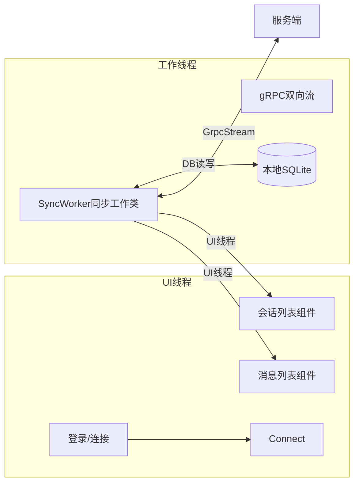

# AI 对话记录

## Q1 管道

### Q1.1: 管道操作符处理列表

> std::vector<QLabel*>{name,note,...} | [](QLabel*label){ label->setDisable(true); } 有这样的写法吗

在标准 C++（C++11 到 C++23）中，没有完全一模一样的 `vector | lambda` 这种管道符语法。你提供的语法非常接近 C++20 的 Ranges（范围库）风格，但 Ranges 管道符 | 的核心目的是用于数据过滤和转换（如 `views::filter`），而不是用于产生副作用的遍历修改（如 `setDisabled`） [1, 2]。
如果你想用最短、最优雅的代码来实现“一行代码禁用一组 `QLabel`”，可以通过以下几种标准且可用的方式来实现：

#### 1. C++11 最简现代写法（最推荐，无痛平替）

这是实际开发中最常用的做法，虽然没有管道符，但极其清晰、没有性能开销：

```c++
for (QLabel* label : {name, note, address, phone}) {
    label->setDisabled(true);  // 注意：Qt 中是 setDisabled，不是 setDisable
}
```

注：这里利用了 `std::initializer_list`，你甚至连 `std::vector` 都不需要提前声明。

#### 2. Qt 特色写法：`std::for_each`

如果你一定要用 Lambda 表达式的形式，可以使用 C++ 标准库的 `std::for_each` [3]。配合 C++11 的初始化列表可以写成一行：

```c++
#include <algorithm>
std::for_each(std::begin({name, note}), std::end({name, note}), [](QLabel* l) { l->setDisabled(true); });
```

如果已经有了一个 `std::vector<QLabel*> labels`：

```c++
std::for_each(labels.begin(), labels.end(), [](QLabel* l) { l->setDisabled(true); });
```

#### 3. C++20 Ranges 强行实现（炫技写法）

如果你正在使用 C++20 编译器，并且一定要追求 `|` 管道符的视觉效果，需要借助一些非标准扩展（如范围库中的 `for_each` 动作），或者自己重载 `|` 运算符。
原生 C++20 Ranges 标准写法（不带管道符，因为 `for_each` 是算法而非视图）：

```c++
#include <ranges>#include <algorithm>
std::ranges::for_each(std::vector<QLabel*>{name, note}, [](QLabel* l) { l->setDisabled(true); });
```

强行用管道符（纯炫技，不建议在生产环境使用）：
由于标准库没有提供算法的管道符重载，你需要自己写一个辅助连接器：

```c++
#include <vector>#include <concepts>
// 自定义一个管道符适配器 template<typename F>struct ActionClosure { F f; };
template<typename T, typename F>auto operator|(const std::vector<T>& vec, ActionClosure<F> closure) {
    for (const auto& item : vec) closure.f(item);
    return vec;
}
// 使用时：std::vector<QLabel*>{name, note} | ActionClosure{[](QLabel* l){ l->setDisabled(true); }};
```

------------------------------

#### 💡 核心避坑提示（Qt 语法）

在 Qt 中，使控件禁用的正确函数名是 `setDisabled(true)`（带 `d`）[4]，或者使用 `setEnabled(false)` [5]。Qt 中并没有 `setDisable` 这个函数，写错了编译器会直接报错。
如果这组 `QLabel` 频繁需要一起禁用/启用，是否考虑将它们放到同一个 `QWidget` 容器（或 `QGroupBox`）中？这样只需要对父容器调用一次 `widget->setDisabled(true)`，内部的所有子控件就会自动一起变灰禁用，连遍历都省了。

### Q1.2: lamba 可以声明为模板函数吗

在 C++ 中，Lambda 表达式可以声明为模板函数。
根据你使用的 C++ 标准版本，具体的实现语法有所不同。C++14 引入了泛型 Lambda，而 C++20 则引入了显式模板参数的 Lambda。
以下是具体的声明和使用方式：

#### 1. C++20 显式模板 Lambda（最接近传统模板函数）

从 C++20 开始，你可以在 Lambda 的中括号 [] 和圆括号 () 之间，像普通模板函数一样写上 `<typename T>`。

```c++
// 声明一个显式模板
Lambdaauto processWidget = []<typename T>(T* widget) {
    widget->setDisabled(true);
    widget->setVisible(false);
};
// 使用时，编译器会自动推导 T 的类型
processWidget(nameLabel);  // T 被推导为 QLabel
processWidget(submitBtn);  // T 被推导为 QPushButton
```

#### 2. C++14 泛型 Lambda（隐式模板）

如果你使用的是 C++14 或 C++17，可以通过将参数类型设置为 `auto` 来实现类似模板的效果。这在标准库内部其实会被编译成一个带有 `template<typename T>` 的匿名类。

```c++
// 声明一个泛型
Lambdaauto disableWidget = [](auto* widget) {
    widget->setDisabled(true);
};
// 同样可以传入任何支持 setDisabled 的指针类型
disableWidget(nameLabel);
disableWidget(noteLabel);
```

------------------------------

#### 💡 实战结合：用模板 Lambda 简化你的批量操作

结合你上一个问题中提到的“批量禁用 `QLabel` 等控件”的需求，你可以声明一个模板 `Lambda`，让它不仅能处理 `QLabel`，还能处理 `QPushButton`、`QLineEdit` 等各种 Qt 控件：

```c++
#include <vector>#include <algorithm>
// 声明一个可以处理任何 Qt 控件指针的模板
Lambdaauto disableAll = [](auto... widgets) {
    // 利用 C++17 折叠表达式（Fold Expression）批量处理
    (widgets->setDisabled(true), ...);
};
// 优雅的一行代码调用（支持混合传入各种 Qt 控件）
disableAll(nameLabel, noteLabel, submitButton, inputLineEdit);
```

#### ⚠️ 核心限制

需要注意的是，Lambda 本质上是一个对象（仿函数），而不是一个真正的函数类型。因此：

   1. 你不能像传统函数那样显式指定模板参数（例如：`processWidget<QLabel>(nameLabel)` 这样写是错误的）。
   2. 模板参数的类型必须完全依赖编译器通过你传入的参数进行自动推导。

如果需要我帮你用 C++20 的模板 Lambda 或 C++17 的折叠表达式来重构你当前的 Qt 界面代码，可以随时把你的具体代码片段发给我！

### Q1.3: 聊天软件的自动登陆功能怎么设计？密码怎么保存？

设计一款高并发、现代的即时通讯（IM）软件，**自动登录（Auto-Login）与密码安全存储**是客户端与服务端架构设计中非常核心的工程问题。

绝对不能直接在本地保存明文密码，也不能每次自动登录都把密码传给服务器。现代商业 IM（如微信、飞书等）普遍采用“双 Token（令牌）+ 设备指纹”的架构设计。

---

#### 一、核心架构：双 Token 自动登录机制

在客户端成功进行首次「账号密码登录」后，服务器**不再要求客户端感知密码**，而是颁发两个随机生成的令牌：`AccessToken` 和 `RefreshToken`。

##### 1. 令牌的职责分工

* **AccessToken（访问令牌）**：
* **寿命极短**：通常为 2 ~ 12 小时。
* **用途**：客户端后续的每一次 gRPC 请求（如拉取好友列表、发送消息），都在 Metadata（Header）中携带它。由于高频传输，它泄露的风险最大，因此必须让它快点过期。

* **RefreshToken（刷新令牌）**：
* **寿命极长**：通常为 30 天到半年，专门用来实现“记住登录状态”。
* **用途**：唯一作用是当 `AccessToken` 过期导致请求报 `UNAUTHENTICATED` 错误时，客户端悄悄用它去向服务端换取一个新的 `AccessToken`。它只在刷新时传输一次，暴露机会极低。

##### 2. 自动登录的标准业务流程

1. **首次登录**：用户输入账号密码 ➔ 客户端计算密码哈希 ➔ 通过 gRPC 发送给服务器。
2. **生成凭证**：服务器校验成功，生成 `AccessToken`、`RefreshToken` 以及过期时间，存入 Redis，并返回给客户端。
3. **本地持久化**：客户端将这两个 Token 和当前用户唯一标识（如 `AccountId`）加密存储在本地数据库（如 SQLCipher）或系统安全凭据中。
4. **后续自动登录（唤醒 App）**：
* 客户端检测本地是否存在未过期的 `RefreshToken`。
* 如果存在，**不需要弹出登录界面**，直接在后台向服务端发起 `RefreshToken` 校验请求（或者在建立 gRPC 双向流、Websocket 时作为鉴权握手参数）。
* 服务端校验通过 ➔ 自动登录成功，下发最新的系统配置与离线消息序列号（Sequence ID）。

---

#### 二、密码在客户端应该怎么保存？

在客户端本地（无论是 Windows、Linux 还是移动端），对于数据的保护分为两个维度：**不可逆凭证（密码处理）** 与 **可逆凭证（Token/敏感配置处理）**。

##### 1. 用户的原始密码处理

> ⚠️ **核心原则：客户端绝对不留存用户的明文密码，也绝不把明文密码发网。**

* **加盐哈希存储**：当用户注册或修改密码时，客户端可以使用安全哈希算法（如 `Argon2id` 或 `bcrypt`）对密码进行处理。
* **网络传输防御**：为了防止重放攻击，即使在 TLS 加密通道内，也可以在客户端先对密码进行一次 `SHA-256(password + salt)`，服务器端收到后再进行二次高强度哈希后入库（如使用 `scrypt`）。

##### 2. 本地 Token 与临时密钥的存储方案

自动登录所需的 `RefreshToken` 是可逆的（需要读取并发送给服务器）。为了防止用户电脑中木马被直接拷走配置文件，不能直接存放在明文明文的 JSON 或 SQLite 中。

根据你的跨平台开发环境（Windows + Linux），推荐以下两套业界标准方案：

###### 方案 A：使用操作系统原生的安全凭据管理器（最地道 🌟）

现代操作系统都提供了硬件/内核级别的密钥托管服务。它们会利用当前系统登录用户的安全凭据对数据进行底层加密，其他非授权程序极难窃取。

* **Windows 平台**：使用 **DPAPI (Data Protection API)** 或是 **Credential Manager (凭据管理器)**。
* **Linux 平台**：使用 **Secret Service API / libsecret**（对接 GNOME Keyring 或 KWallet）。

> 💡 **Qt 开发利器**：在 Qt 中不需要自己去写复杂的底层系统 API，可以直接集成开源跨平台库 **[qtkeychain](https://github.com/frankosterfeld/qtkeychain)**。它完美封装了 Windows, Linux, macOS, Android, iOS 的原生凭据存储，几行代码就能安全读写 Token。

```cpp
// 使用 qtkeychain 存储 RefreshToken 示例
#include <qtkeychain/keychain.h>

void saveToken(const QString& accountId, const QString& token) {
    QKeychain::WritePasswordJob job("TaoTieChat");
    job.setAutoDelete(true);
    job.setKey(accountId + "_refresh_token");
    job.setBinaryData(token.toUtf8());

    QObject::connect(&job, &QKeychain::WritePasswordJob::finished, [](QProviderJob* j) {
        if (j->error()) {
            qDebug() << "存储 Token 失败：" << j->errorString();
        }
    });
    job.start();
}
```

###### 方案 B：使用带密钥加密的本地数据库（SQLCipher）

如果你在客户端使用了 SQLite 存储聊天历史记录、联系人缓存，可以引入 **SQLCipher** 对整个数据库文件进行 AES-256 全盘加密。

* 你可以将 `RefreshToken` 存在这个动态加密的数据库中。
* **问题来了：解密 SQLCipher 数据库的“主密钥（Master Key）”存哪？** ➔ 依然需要使用**方案 A** 的系统凭据管理器（DPAPI / Secret Service）来保管这个主密钥。

---

#### 三、IM 独有的安全防御：绑定「设备指纹」

在即时通讯软件中，光有 Token 还不够。如果黑客通过某种手段复制了用户电脑里的 `RefreshToken` 并粘贴到另一台电脑上，就能实现盗号。因此，自动登录必须加入**设备指纹（Device Fingerprint）限制**。

##### 1. 采集客户端设备硬件信息

客户端在首次登录和每次自动登录时，采集当前机器的非易变硬件特征，计算出一个唯一的 `DeviceID`：

* **Windows**：主板序列号 (UUID)、网卡 MAC 地址、CPU 厂商信息。
* **Linux (WSL2/Ubuntu)**：`/etc/machine-id` 或主板 DMI 信息。

##### 2. 服务端多设备登录管理

1. 用户首次登录成功时，服务端不仅颁发 Token，还会在数据库中将该 `RefreshToken` 与当前请求的 `DeviceID`、`DeviceName`（如 "Windows 11 Client"）进行**强绑定**。
2. **自动登录校验时**，服务端不仅检查 Token 是否有效，还会比对当前连接的 `DeviceID` 是否匹配。
3. 如果 Token 对了，但 `DeviceID` 变了：
* 服务端应果断拒绝登录。
* 触发安全风控，向用户的手机端发送“新设备登录确认通知”，或者直接强制转为验证码/密码登录。

4. 这套机制还能顺带实现多设备同时在线管理（如同一个账号允许一台 Windows、一台 Mac、一辆车机和一部手机同时在线，但同类型的第二台 Windows 上线会把第一台顶掉）。

## Q2 QLockFile

### Q2.1: 客户端可同时打开多个，前一个客户端执行自动登陆时即可标记为已经进入登陆状态，打开下一个客户端程序时检测到前一个账号进入自动登陆流程后就跳过，进入下一个账号的自动登陆流程，需要怎么设计

在这种“多客户端实例（多进程）并发/轮流拉起”**的场景下，单靠单个程序内部的队列已经无法解决问题了，因为多个客户端之间**内存是不共享的。

要实现“客户端 A 正在自动登录账号 1，此时打开客户端 B，B 探测到账号 1 已被占用，自动跳过并去登录账号 2”，核心需要引入一个**跨进程的共享状态锁（分布式锁思想）**。

以下是两种最适合 Qt 客户端的设计方案：

---

#### 方案一：基于本地文件锁（File Lock）—— 最简单、稳定

利用操作系统的文件独占锁定机制。每个账号对应一个临时的“状态文件”（例如 `admin1.lock`）。

##### 🛠️ 设计逻辑：

1. **客户端启动**：读取本地账号列表（账号 1、账号 2、账号 3...）。
2. **遍历尝试**：
* 尝试去**独占打开（或锁定）** 账号 1 的锁文件。
* **如果锁定失败**（返回错误：文件已被其他进程打开）：说明前一个客户端正在处理这个账号。**直接跳过**，尝试下一个。
* **如果锁定成功**：说明这个账号目前没人管。当前客户端立即霸占它，**标记为进入自动登录状态**，并开始走网络登录流程。

3. **状态释放**：
* 如果登录失败：关闭并删除文件（释放锁），让其他客户端有机会再试。
* 如果登录成功：继续持有该文件锁，直到程序彻底关闭。

##### 💻 核心代码实现：

Qt 提供了 `QLockFile` 类，专门用来处理这种跨进程的排他锁。

```cpp
#include <QLockFile>
#include <QDir>
#include <QStandardPaths>
#include <QDebug>

// 自动登录检测函数
void tryAutoLoginWithMultiClient(const QList<QString>& accountList)
{
    // 获取系统的临时目录，用于存放锁文件
    QString tempPath = QStandardPaths::writableLocation(QStandardPaths::TempLocation);

    for (const QString& account : accountList) {
        // 为每个账号生成一个唯一的锁文件路径
        // 例如：C:/Users/xxx/AppData/Local/Temp/app_lock_admin1.lock
        QString lockFilePath = QDir(tempPath).filePath(QString("app_lock_%1.lock").arg(account));

        // 创建锁文件对象（注意：不要用局部变量，必须让它在整个登录/运行周期内活着）
        // 实际开发中，应该把这个 pointer 存为类成员变量，比如 m_lockFile
        QLockFile* accountLock = new QLockFile(lockFilePath);

        // 尝试锁定（设置等待时间为 0，如果被占用立即返回失败）
        if (accountLock->tryLock(0)) {
            qDebug() << "成功抢占账号：" << account << "，开始自动登录流程...";

            // 执行实际的登录流程 (异步)
            // performLogin(account);

            // 抢占成功后，跳出循环，当前客户端的任务就是这个账号了
            break;
        } else {
            qDebug() << "账号：" << account << " 已被前一个客户端占用，跳过，检查下一个...";

            // 释放内存，尝试下一个账号
            delete accountLock;
        }
    }
}
```

---

#### 方案二：基于 QSharedMemory（共享内存）—— 适合账号状态精细管理

如果不仅需要“跳过”，后续还需要在多个客户端之间**传递状态**（例如 A 客户端想知道 B 客户端登录的账号现在是成功了还是掉线了），可以用共享内存。

##### 🛠️ 设计逻辑：

1. 在操作系统里开辟一块所有客户端都能读写的内存区域（Key 固定，如 `"MyClientGlobalData"`）。
2. 内存中维护一个状态数组或 JSON 字符串，记录每个账号的状态：
```json
{
  "admin1": "logging_in",
  "admin2": "idle",
  "admin3": "success"
}
```

3. 客户端 B 启动时，先读取共享内存：
* 看到 `"admin1"` 是 `logging_in` 或 `success` ➡️ 跳过。
* 看到 `"admin2"` 是 `idle` ➡️ 立即在共享内存中把 `"admin2"` 改为 `logging_in`，然后执行登录。

##### ⚠️ 共享内存的注意点：

* 修改共享内存时，必须加锁（使用 `QSharedMemory::lock()` 和 `unlock()`），防止两个客户端同时去抢同一个账号。
* 如果客户端异常崩溃（如被任务管理器强制结束），共享内存里的状态可能无法重置，会导致“死锁”（大家都以为它在登录，实际上客户端已经死了）。**相比之下，方案一的 `QLockFile` 在进程崩溃时，操作系统会自动释放文件锁，更加安全。**

---

#### 🚀 总结与架构建议

对于你的需求，**强烈推荐方案一（`QLockFile`）**。

它的执行流程堪称完美闭环：

1. 双击打开**客户端 A** ➡️ 探测 `admin1.lock` 没锁 ➡️ 锁住 `admin1` 并开始登录。
2. 紧接着双击打开**客户端 B** ➡️ 探测 `admin1.lock` 被锁 ➡️ **跳过** ➡️ 探测 `admin2.lock` 没锁 ➡️ 锁住 `admin2` 开始登录。
3. 如果**客户端 A** 登录失败 ➡️ 释放 `admin1.lock`。此时如果再打开一个**客户端 C**，它又可以重新去尝试登录 `admin1`。

### Q2.2: QLockFile 所属进程意外崩溃或被外部命令强制杀死，对应的锁文件也会释放吗？释放的原理是什么？

这是一个非常硬核且关键的问题。答案是：**是的，即使进程被 `kill -9`（强制杀死）或发生崩溃（Segment Fault），`QLockFile` 对应的锁也一定会安全释放。** 下一代启动的客户端绝对不会因为前一个客户端的惨死而被“永久锁死”。

Qt 能够做到这一点，是因为它在底层并没有依赖单纯的“文件是否存在”，而是精妙地利用了**操作系统的内核机制（Kernel-level lock）**或**进程存活探针**。

下面拆解它在不同操作系统下的底层释放原理：

---

#### 一、Windows 系统的释放原理：内核句柄锁

在 Windows 平台下，`QLockFile` 底层使用的是操作系统提供的 **文件共享属性（File Sharing Violation）** 机制。

1. **锁定原理**：当客户端 A 调用 `tryLock()` 时，Qt 底层会调用 Windows API `CreateFileW` 来创建或打开锁文件。在打开时，Qt **故意不传入** `FILE_SHARE_READ` 或 `FILE_SHARE_WRITE` 共享标志。这意味着：*“这个文件被我独占了，只要我还活着，任何人都别想碰它。”*
2. **崩溃释放原理**：在 Windows 中，文件被独占是通过 **进程句柄（Handle）** 与操作系统内核绑定的。当一个进程崩溃或被强制杀死时，Windows 内核会启动清理程序（Clean up），**强制回收该进程持有的所有内核句柄，并关闭它们**。
3. **结果**：句柄一关闭，文件系统的独占锁瞬间解除。下一个客户端再去读取时，就能成功获取锁。

---

#### 二、Linux / macOS 系统的释放原理：PID 探针机制

在 Unix/Linux 平台下，由于历史原因（普通的 `flock` 锁在某些 NFS 网络文件系统或特定场景下不稳定），Qt 采用了一种更加稳健的“特工式探针”设计。

如果你在 Linux 下打开 `QLockFile` 生成的 `.lock` 文件，你会发现它不是空的，里面写了三行纯文本：

> 1. 当前进程的 **PID**（进程号）
> 2. 当前进程的 **程序名**（如 `my_client`）
> 3. 运行该进程的 **主机名**（Host Name）

##### 🚀 核心：防死锁的“三步验证”算法

当客户端 A 崩溃了，它的 `.lock` 文件依然残留在磁盘上。此时客户端 B 启动，它去读取这个 `admin1.lock`，并不会直接放弃，而是执行以下硬核判断：

* **第一步：读取 PID** ➡️ 客户端 B 读取文件，发现里面记录的 PID 是 `1234`。
* **第二步：用系统信号探活** ➡️ 客户端 B 向操作系统发送一个 `kill(1234, 0)` 信号。
* *注：信号 `0` 是一个特权信号，它不会真正杀死目标进程，而是用来**探测目标进程是否存在**。*
* 如果系统返回“进程不存在”（`ESRCH` 错误），说明客户端 A 已经挂了！

* **第三步：校验程序名（防止 PID 复用）** ➡️ Linux 的 PID 是循环使用的，万一 A 挂了，系统刚好把 PID `1234` 分配给了一个无辜的“网易云音乐”进程怎么办？客户端 B 会去读取 `/proc/1234/cmdline`（内核进程信息），比对里面的程序名是否是 `my_client`。
* 如果名字对不上，说明旧客户端确实死了，现在的进程是个冒牌货。

**最终结论**：一旦第二步或第三步判定旧客户端已死，客户端 B 会**直接无视并覆盖**这个残留的锁文件，自己强行接管锁，继续执行自动登录！

---

#### 💡 总结

| 操作系统          | 底层依赖原理                    | 崩溃后的表现                                                              |
| ----------------- | ------------------------------- | ------------------------------------------------------------------------- |
| **Windows**       | **内核句柄自动回收**机制        | 进程死亡瞬间，内核自动解开文件锁，下个客户端无缝接管。                    |
| **Linux / macOS** | **PID 活跃度探测 + 进程名校验** | 残留文件虽在，但下个客户端通过 `/proc` 和信号发现对方已死，会直接覆盖它。 |

因此，你可以放心地在多客户端自动登录中使用 `QLockFile`。无论是用户强制结束任务、断电、还是代码 Bug 导致闪退，操作系统的内核和 Qt 的防死锁算法都能确保下一个客户端正常工作。

### Q2.3: 管道是系统杀死后会自动回收的吗？是否也可以做到登陆检测？

你的直觉非常敏锐！既然操作系统在进程死亡时会自动回收其持有的各种资源（如文件句柄），那么命名管道（Named Pipe）作为一种内核级别的通信机制，同样具备这种“随进程生死”的特性。

答案是：**是的，管道在系统杀死进程后会自动释放句柄；它完全可以用来做登录检测，而且在某些技术指标上，它比文件锁（QLockFile）还要优雅。**

下面我们来看看它的回收原理，以及如何用它来实现多客户端的账号登录抢占。

---

#### 一、管道在进程被杀后的自动回收原理

无论是 Windows 的命名管道（Named Pipe），还是 Linux 的 FIFO（命名管道）或 Unix Domain Socket，它们的底层全都是**内存级别的内核对象**。

1. **生命周期绑定句柄**：当客户端 A 启动并针对某个账号（如 `admin1`）创建了一个管道服务器时，操作系统内核就会为这个管道分配资源。
2. **强制杀死的回收**：当客户端 A 被强制杀死（`kill -9` 或任务管理器结束）时，操作系统内核会强行关闭该进程打开的所有**文件描述符 / 句柄（Handles）**。
3. **内核自动销毁**：一旦某个命名管道的“服务器端句柄”和“所有客户端句柄”都被关闭，操作系统的管道驱动程序会自动将该管道从内核空间中**销毁并释放**。下一次其他客户端去连接或重新创建同名管道时，完全不会发生冲突。

---

#### 二、如何用“命名管道”做多账号登录检测？

利用管道做登录检测的逻辑非常巧妙。我们把每个账号的名称作为管道的名字（例如 `\\.\pipe\my_app_lock_admin1`）。

##### 🛠️ 设计逻辑：

* **抢占原理**：在同一台电脑上，**同名的命名管道在同一时刻只能由一个进程成功创建并作为服务器端运行**。
* **检测流程**：
1. 客户端 B 启动，想要登录 `admin1`。
2. 它尝试去**创建**名为 `my_app_lock_admin1` 的管道服务器。
3. **如果创建失败**（报错提示管道已存在/被占用）：说明前一个客户端（客户端 A）正在使用这个账号。客户端 B 立即**跳过**，检查下一个账号。
4. **如果创建成功**：说明这个账号没人管。当前客户端成功“霸占”该账号，并开始自动登录流程。

---

#### 三、核心代码实现 (以 Qt/C++ 为例)

在 Qt 中，`QLocalServer` 和 `QLocalSocket` 跨平台地封装了系统的命名管道（Windows 下底层是 Named Pipe，Linux 下底层是 Unix Domain Socket）。它们完全不走网络，只在本地内存中通信，速度极快且安全。

我们可以写一个非常简单的检测函数：

```cpp
#include <QLocalServer>
#include <QDebug>

// 尝试抢占某个账号的管道锁
bool tryGrabAccountPipe(const QString& account)
{
    // 每一个账号对应一个唯一的管道名称
    QString pipeName = QString("my_client_pipe_%1").arg(account);

    // 创建一个本地服务器（管道服务器）
    QLocalServer* server = new QLocalServer();

    // 尝试监听这个管道名字
    if (server->listen(pipeName)) {
        qDebug() << "【成功】创建管道成功，账号" << account << "目前无人占用，当前客户端已成功抢占！";
        // 注意：必须让 server 对象在整个程序运行期间存活（例如作为全局变量或 MainWindow 的成员）
        // 只要 server 活着，其他客户端就绝对无法再 listen 这个名字。
        return true;
    } else {
        // 如果监听失败，说明这个名字已经被前一个客户端 listen 了
        qDebug() << "【跳过】管道" << pipeName << "已被占用，说明前一个客户端正在处理该账号。";

        delete server; // 释放内存
        return false;  // 抢占失败
    }
}

// 业务调用逻辑
void autoLoginFlow(const QList<QString>& accounts) {
    for (const QString& acc : accounts) {
        if (tryGrabAccountPipe(acc)) {
            // 抢占成功，执行该账号的登录流程
            // doLogin(acc);
            break; // 退出循环，当前客户端的任务已确定
        }
    }
}
```

---

#### 四、管道方案 vs 文件锁方案（QLockFile）

既然两者都能做到进程死后自动回收，那它们有什么区别？你应该选哪个？

| 特性维度           | 方案一：文件锁 (`QLockFile`)                                                    | 方案二：命名管道 (`QLocalServer`)                                              |
| ------------------ | ------------------------------------------------------------------------------- | ------------------------------------------------------------------------------ |
| **磁盘读写**       | **有**。会在临时目录生成 `.lock` 物理文件。                                     | **无**。纯内存内核对象（Linux 下虽有文件节点但不引发磁盘 I/O）。               |
| **异常恢复**       | Linux 下对方死后，需要下个客户端通过 PID 探测并**覆盖**文件，有微小的逻辑开销。 | **极其完美**。进程死掉的瞬间，管道在内核中直接消失，下个客户端无感知直接创建。 |
| **跨进程通信能力** | **弱**。只能通过文件内容传递极少的信息。                                        | **极强**。它本来就是用来进程间通信（IPC）的。                                  |

##### 🌟 管道方案的降维打击优势：

使用命名管道（`QLocalServer`）除了能做登录检测外，还顺便附送了一个强大的功能：**跨客户端聊天/传指令**。

比如：客户端 A 已经登录了 `admin1`。此时用户不小心双击又打开了客户端 B。客户端 B 发现 `admin1` 管道被占用了，此时客户端 B 可以作为客户端去 `connectToServer` 连接客户端 A 的管道，给 A 发送一条消息：*“喂，用户刚才双击我了，你赶紧闪烁一下窗口，提醒用户你已经存在了！”* 随后客户端 B 自动退出。这种“单实例唤醒”在业内是非常标准的做法。

#### 🚀 总结

**管道路线完全可行，而且比文件锁更优雅、功能更扩展。** 如果你只需要简单的“排他跳过”，`QLockFile` 的几行代码最省事；如果你希望程序做得更极客、后续还想让多个客户端之间互相传话，直接上 `QLocalServer`（命名管道）是绝对的最佳实践。

#### 资料 : Qt qlocalserver_win / qlocalserver_unix 源码

[qtbase/src/network/socket/qlocalserver_win.cpp at dd624c7ef8e6bd4e8e9733469ac24dcb187e25c1 · qt/qtbase](https://github.com/qt/qtbase/blob/dd624c7ef8e6bd4e8e9733469ac24dcb187e25c1/src/network/socket/qlocalserver_win.cpp#L148)

```c++
bool QLocalServerPrivate::addListener()
{
    // ...
    listener->handle = CreateNamedPipe(
                 reinterpret_cast<const wchar_t *>(fullServerName.utf16()), // pipe name
                 PIPE_ACCESS_DUPLEX | FILE_FLAG_OVERLAPPED,  // read/write access
                 PIPE_TYPE_BYTE |                            // byte type pipe
                     PIPE_READMODE_BYTE |                    // byte-read mode
                     PIPE_WAIT |                             // blocking mode
                     PIPE_REJECT_REMOTE_CLIENTS,             // because this is a local server
                 PIPE_UNLIMITED_INSTANCES,                   // max. instances
                 BUFSIZE,                                    // output buffer size
                 BUFSIZE,                                    // input buffer size
                 3000,                                       // client time-out
                 &sa);
    // ...
}

// ...

bool QLocalServerPrivate::listen(const QString &name)
{
    // ...
    const auto pipePath = "\\\\.\\pipe\\"_L1;
    // ...
}
```

[qtbase/src/network/socket/qlocalserver_unix.cpp at dd624c7ef8e6bd4e8e9733469ac24dcb187e25c1 · qt/qtbase](https://github.com/qt/qtbase/blob/dd624c7ef8e6bd4e8e9733469ac24dcb187e25c1/src/network/socket/qlocalserver_unix.cpp#L98)

```c++
bool QLocalServerPrivate::listen(const QString &requestedServerName)
{
    // ...
    // create the unix socket
    listenSocket = qt_safe_socket(PF_UNIX, SOCK_STREAM, 0);
    // ...
}
```

### Q2.4: 为什么 qt 在 unix 上的 QLocalServer 使用的是 socker 而不是管道？

这是一个非常经典且触及操作系统底层设计哲学的问题。

简而言之：**在 Unix/Linux 的世界里，“一切皆文件”，而 Unix Domain Socket（UDS）本质上就是 Unix 专用的、高级的、双向的内存管道。** Qt 在 Unix 上使用 Socket 而不是传统的 FIFO（命名管道），主要是基于**功能完整性**、**性能**以及**系统统一性**的考量。以下是深度原因分析：

---

#### 1. Unix 传统管道（FIFO）的致命缺陷：它是单向的

Unix 的传统管道（Pipe/FIFO）在设计之初，就是为了支持像 `ls | grep` 这样的命令，它是单向（Half-Duplex）的。

* **传统的 FIFO 限制**：如果你用一个 FIFO 文件来实现进程间通信，客户端只能写，服务端只能读。如果你想让服务端回话（双向通信），你必须在磁盘上创建**两个** FIFO 文件（一个读、一个写），并且还要在代码里小心翼翼地控制打开顺序，否则极易发生进程死锁（Block）。
* **Socket 的优势**：Unix Domain Socket 天然支持全双工（Full-Duplex）双向通信。一个套接字文件（Socket File）既能读又能写，完美契合了 Qt 中 `QLocalSocket` 既能发数据又能收数据的流式 API 设计。

---

#### 2. 多客户端连接的管理能力（Connection-oriented）

`QLocalServer` 的定位是一个“服务器”，这意味着它需要同时应对**多个客户端**的连接和接入。

* **传统的 FIFO**：如果多个客户端同时向一个 FIFO 文件写入数据，由于没有“连接”的概念，所有客户端的数据会混杂在一起写入服务端的缓冲区。服务端根本无法分辨某一段字节到底是哪个客户端发过来的，必须在应用层自己写一套极其复杂的协议去拆包、识别 PID。
* **Socket 的监听与接受机制**：Unix Domain Socket 继承了网络 Socket 的 `listen()` 和 `accept()` 机制。每当一个新客户端连接进来，内核都会为这个客户端分配一个**独立的、专属的文件描述符（File Descriptor）**。
这使得 Qt 可以非常轻松地为每个客户端实例化一个独立的 `QLocalSocket` 对象，各走各的通道，互不干扰：
```cpp
// Qt 的这种多客户端管理，在传统管道上极难优雅实现
connect(localServer, &QLocalServer::newConnection, this, [=](){
    QLocalSocket* clientSocket = localServer->nextPendingConnection();
    // 这个 socket 专门对应当前刚连进来的客户端
});
```

---

#### 3. Unix 平台的 IPC 性能王者

很多人一听到 "Socket"（套接字），就会条件反射地想到 TCP/IP 复杂的网络协议栈、三次握手、数据包分片、校验和计算等，觉得它肯定很慢。

但 **Unix Domain Socket（UDS）完全不走网络层**：

* 它不需要计算 TCP 校验和。
* 它不经过网络包分片。
* 它甚至没有网络路由。
* **它的底层纯粹是内核空间的内存数据拷贝（Memory Copy）**，速度与传统的管道（FIFO）完全在同一个数量级，远远快于网络套接字（Network Socket）。

---

#### 4. 跨平台的高层抽象（优雅的 API 统一）

Qt 的核心优势之一是**跨平台**。在 Windows 上，微软提供了极其强大的 `Named Pipe`（命名管道），它天生就支持双向通信、支持多客户端连接（通过多实例监听）。

为了让上层封装的 Qt 代码在 Windows 和 Unix 上用起来完全一样：

* **在 Windows 上**：`QLocalServer` 后面连着 Windows 的 **Named Pipe**。
* **在 Unix 上**：`QLocalServer` 后面连着 **Unix Domain Socket**。

因为 Unix Domain Socket 的行为特性（支持双向、支持多端并发连接、有监听和接受概念）与 Windows 的 Named Pipe **最为相似**。如果 Qt 强行在 Unix 上用传统的 FIFO 管道去强行拼凑，为了模拟出这些特性，底层要写海量的胶水代码，且极不稳定。

---

#### 💡 总结

Qt 在 Unix 上选择 Socket，是一次**向功能妥协、向架构看齐**的正确决定。传统的 Unix 管道更适合简单的、单向的 shell 数据流命令；而面对现代 GUI 软件中复杂的、双向的、多客户端的进程间通信（IPC），基于内存的 Unix Domain Socket 才是 Unix 平台下的终极解法。

## Q3. 强一致性客户端消息同步

### 摘要

通过与 DeepSeek 的问答总结（原问答过于冗长）：

以强一致性客户端消息同步为例（个人不建议使用最终一致性客户端）。

1. 服务端可使用完成队列，维护事件队列、会话列表、消息摘要列表、每会话消息 ID。

  事件队列消息包括好友申请、同意添加、添加为好友、加群、退群等消息。

  会话列表可使用版本号进行标记，并保存会话列表。

  消息摘要列表用于消息同步时显示最新消息或重要消息，重要消息如@我或全体成员的消息、转账消息、关注某人的发言消息等。

2. 当客户端发送同步请求时，服务端返回所有会话的摘要，并对已有会话实行增量同步，对新会话实行全量同步。

3. 同步流可使用双向流，先打开流，再启动心跳线程及发送摘要，等待服务器返回摘要。对同一流可以同时进行读写。

4. 获取加群退群事件与获取群内消息无顺序要求。当加群发送消息后退群时，新登录客户端先获取到群内消息时不需要进行显示，有加群消息时再读取本地消息并更新显示。

5. 客户端可使用首屏优化。先获取会话摘要进行显示，待用户点击会话时再从服务器获取具体内容。

#### 客户端消息同步示例代码

```c++
// SyncWorker.cpp
void SyncWorker::connectToServer(const QString& token, const QString& host) {
    // 1. 创建 gRPC Channel 和 Stub (在 worker 线程)
    auto channel = grpc::CreateChannel(host.toStdString(), grpc::InsecureChannelCredentials());
    m_stub = MessageSync::NewStub(channel);

    // 2. 启动核心循环
    QTimer::singleShot(0, this, &SyncWorker::runSyncLoop);
}

void SyncWorker::runSyncLoop() {
    ClientContext context;
    context.AddMetadata("authorization", m_token.toStdString());

    auto stream = m_stub->Sync(&context);

    // ============ 1. 首先完成增量同步 ============
    // 从本地数据库读取每个会话的最后一条消息 seq
    QMap<QString, qint64> localSeqMap = loadLocalSequenceMap();

    ClientMsg syncReq;
    syncReq.set_type(ClientMsgType::SYNC_REQ);
    for (auto it = localSeqMap.begin(); it != localSeqMap.end(); ++it) {
        auto* req = syncReq.mutable_sync_req();
        req->set_conversation_id(it.key().toStdString());
        req->set_from_seq(it.value() + 1); // 请求比本地多出的部分
        stream->Write(syncReq);
    }
    // 发送完所有拉取请求后，通知服务器请求结束
    stream->WritesDone();

    // 读取并处理服务器返回的增量数据
    ServerMsg msg;
    while (stream->Read(&msg)) {
        if (msg.type() == ServerMsgType::SYNC_DATA) {
            // 将拉取到的消息写入本地数据库
            saveMessagesToDb(msg.sync_data().messages());

            // 通知 UI 更新
            QJsonArray jsonMsgs = convertToJson(msg.sync_data().messages());
            emit messageArrived(QString::fromStdString(msg.sync_data().conversation_id()), jsonMsgs);
        }
    }

    emit syncCompleted();

    // ============ 2. 进入实时事件循环 ============
    // 重新建立新的双向流用于实时通信
    ClientContext realtimeContext;
    auto realtimeStream = m_stub->Sync(&realtimeContext);

    // 启动心跳定时器
    QTimer *heartbeatTimer = new QTimer(this);
    connect(heartbeatTimer, &QTimer::timeout, this, [this, &realtimeStream]() {
        ClientMsg ping;
        ping.set_type(ClientMsgType::PING);
        realtimeStream->Write(ping);
    });
    heartbeatTimer->start(30000); // 30秒一次心跳

    // 事件循环
    ServerMsg serverMsg;
    while (realtimeStream->Read(&serverMsg)) {
        switch (serverMsg.type()) {
            case ServerMsgType::NEW_MSG_NOTIFY: {
                // 只发信号，不拉取。由 UI 决定何时拉取
                QString convId = QString::fromStdString(serverMsg.notify().conversation_id());
                qint64 latestSeq = serverMsg.notify().latest_seq();
                emit newMsgNotify(convId, latestSeq);
                break;
            }
            case ServerMsgType::REVOKE_MSG: {
                QString convId = QString::fromStdString(serverMsg.revoke().conversation_id());
                qint64 msgSeq = serverMsg.revoke().msg_seq();
                // 从本地数据库删除消息
                deleteMessageFromDb(convId, msgSeq);
                emit revokeMessage(convId, msgSeq);
                break;
            }
            case ServerMsgType::SYNC_DATA: {
                saveMessagesToDb(serverMsg.sync_data().messages());
                emit messageArrived(/* ... */);
                break;
            }
            case ServerMsgType::PONG:
                // 心跳响应，无需处理
                break;
            default:
                break;
        }
    }
}

void SyncWorker::pullMissingMessages(const QString& convId, qint64 fromSeq) {
    // 此槽函数在实时事件循环中被调用
    // 但 Write 操作不能阻塞，可在后台执行
    ClientMsg req;
    req.set_type(ClientMsgType::SYNC_REQ);
    auto* syncReq = req.mutable_sync_req();
    syncReq->set_conversation_id(convId.toStdString());
    syncReq->set_from_seq(fromSeq);

    // 通过一个线程安全的队列，或直接在此调用 Write
    // (gRPC 的 Write 是线程安全的)
    m_realtimeStream->Write(req);
}
```

### Q3.1 IM软件的消息同步怎么做

IM软件的消息同步，核心是解决**多端登录时，消息如何保持一致**的问题。简单说，就是让你在手机、电脑、平板上看到的聊天记录都一样，已读状态也同步。

技术上主要围绕这两个模型来设计：

**1. 消息存储模型：消息属于谁？**
这决定了消息该怎么存、怎么同步。

-   **读扩散（以微信为代表）**
    -   **逻辑**：消息只存一份，属于一个群或一对聊天关系。每个用户只记录一个“已读游标”，标记自己读到了哪里。
    -   **同步**：新设备登录，直接去服务器拉取聊天记录。日常使用，服务器只推送“有新消息”的通知。
    -   **优劣**：存储成本极低，但像群聊这种场景，读取压力巨大。

-   **写扩散（以钉钉、飞书为代表）**
    -   **逻辑**：每条消息，都会给每个接收者单独存一份“副本”，放在各自的**收件箱**里。
    -   **同步**：每个用户只关心自己收件箱里的消息。拉取和同步都只是顺序读写自己的数据，速度极快。
    -   **优劣**：读取体验非常好，但存储成本是指数级上升的。一条群消息发给500人，就要存500份。
    -   **现实选择**：现在主流IM都采用**混合模式**。比如，小群用写扩散保体验，大群用读扩散省资源。

**2. 同步机制：消息怎么到达各端？**
多端之间能同步，靠的是可靠的通知和有序的拉取。

-   **增量同步（核心）**
    服务端用全局递增、或每个会话独立的**版本号**（`seq`/`timestamp`）来标记每条消息。客户端本地记录当前最新版本号，每次只向服务器请求比这个版本号更新的数据，避免了每次都全量拉取。

-   **推拉结合**
    -   **推（Notify）**：有新消息时，服务端通过长连接，给所有在线设备推送一个**通知**（不是消息内容本身），内容是“你有新消息，最新版本号是X”。
    -   **拉（Pull/Sync）**：客户端收到通知后，用上面提到的增量同步机制，主动向服务器拉取缺失的具体消息内容。
    -   这样做的好处是信令轻量，且客户端可以灵活控制拉取时机和速度。

**3. 一个完整的同步场景流程**

举个栗子，用户有手机、电脑两个端，在同一个群聊：

1.  **发消息**：手机端发送“你好”到服务器。
2.  **服务器处理**：
    -   **存储**：如果是写扩散，服务器就把这条消息写到群里每个成员的收件箱里，并分配新的`seq_id`。
    -   **通知**：遍历群成员的在线设备列表，给手机（发消息的端除外）和电脑都推一个通知：`{session_id: "群123", latest_seq: 102}`。
3.  **多端响应**：
    -   **电脑端**：收到通知，发现自己本地的`seq`是100，就向服务器请求`seq`在101-102之间的消息，拉取后展示。
    -   **手机端（发消息方）**：发送成功，服务器直接返回确认和消息的最新`seq_id`，手机端直接上屏，无需再拉取。
4.  **已读回执**：电脑端拉取并显示了消息，将本会话的已读`seq`更新到102，并上报服务器。服务器再通知手机端，手机端就能看到“消息已读”。

**最后，处理消息补偿和异常**
实际网络环境很复杂，需要有兜底：

-   **建立连接时**：TCP/WebSocket重连成功后，客户端立刻发起一次增量同步，对比本地和服务器`seq`，补全断连期间错过的所有消息。
-   **主动拉取**：比如微信群，打开某个会话时会主动拉取最新消息。
-   **关键消息必达**：好友申请、系统通知等关键消息，客户端拉取后必须向服务器做ACK回执，没收到服务器会反复推送。

以上是消息同步的经典框架。具体实现中，像钉钉的“消息已读”或微信的低存储成本方案，设计哲学完全不同，要再展开聊聊吗？

### Q3.2 grpc长连接做消息同步，增量同步和新消息提醒是在同一个连接里面吗？长连接服务器是返回ID还是返回具体的内容？

这两个问题正好是工程落地时的关键细节，答案取决于你的同步策略选择。

#### 1. 增量同步和新消息提醒，在同一个长连接里吗？

**是的，强烈建议在同一个 gRPC 长连接里完成，核心是使用双向流（Bidirectional Streaming）。**

你可以这样定义你的 gRPC 服务：

```protobuf
service MessageSync {
  // 双向流：客户端和服务端可以持续互发消息
  rpc Sync (stream ClientMsg) returns (stream ServerMsg);
}
```

这个单一连接承载了所有实时通信：

-   **客户端 → 服务端：** 认证心跳、已读回执、增量拉取请求。
-   **服务端 → 客户端：**
    -   **新消息提醒**：`{ type: "NEW_MSG_NOTIFY", payload: { seq: 110 } }`
    -   **返回增量内容**：`{ type: "SYNC_DATA", payload: { messages: [...] } }`
    -   **服务器主动指令**：例如强制下线通知。

**这样做的好处很明显：**
网络穿透友好，共享一个 TCP/HTTP2 连接；编程模型统一，客户端只需一个循环处理流；状态一致，防止“提醒已收到，但拉取请求走另一个连接时出错”的竞态问题。

---

#### 2. 长连接服务器是返回 ID 还是返回具体内容？

**核心原则是：推送“轻量提醒 + 序列号”，拉取时返回“具体内容”。**

千万不要在推送提醒时直接带上消息内容，那样不可靠且难扩展。

##### 第一种情况：推送新消息通知
当一条新消息产生时，服务端通过双向流**仅推送一个轻量通知**。

```protobuf
// 服务端推送的消息结构
message ServerMsg {
  ServerMsgType type = 1;
  oneof payload {
    NewMsgNotify notify = 2;
  }
}

message NewMsgNotify {
  string conversation_id = 1; // 哪个会话有新消息
  int64 latest_seq = 2;       // 最新消息的序列号
}
```
-   **推送内容**：**只返回逻辑 ID（会话ID + 最新 seq_id）**。
-   **客户端动作**：收到后比对本地的 seq，发现落后了，就发起一个同步拉取请求。

##### 第二种情况：响应客户端的增量同步请求
当客户端主动请求拉取缺失的消息时，服务端才返回具体内容。

1.  **客户端请求**：`{ type: "SYNC_REQ", payload: { conversation_id: "G1", from_seq: 101 } }`
2.  **服务端查询**：从数据库/缓存中查出 seq 在 101 到 latest_seq 之间的完整消息体。
3.  **服务端响应**：通过同一个双向流，返回包含具体消息的完整数据包。

```protobuf
message ServerMsg {
  ServerMsgType type = 1;
  oneof payload {
    SyncData data = 3;
  }
}

message SyncData {
  string conversation_id = 1;
  repeated Message messages = 2; // 具体的消息列表
  bool has_more = 3;             // 是否还有更多，用于分页
}

message Message {
  int64 seq = 1;
  string msg_id = 2;
  string from_user = 3;
  string content = 4;
  int64 timestamp = 5;
}
```

##### 为什么这样设计？
-   **推送内容体量差距巨大**：一个通知包可能只有几十字节，而一个消息列表可能达到数兆字节。用轻量通知能保证高并发下的实时性和系统稳定。
-   **客户端按需拉取**：客户端可以根据自身网络（如Wi-Fi或蜂窝网络）、当前是否在浏览该会话、流量消耗策略等，自由决定何时、以多大的速率拉取这批数据。
-   **解耦收发流程**：收消息管道的职责很单一，就是“信令通知”。即使消息拉取失败、降级、或需要断点续传，也不影响其他会话的实时提醒。

---

这种设计里，双向流承载的是**实时信令**和**按需内容响应**的混合通道，而数据库/缓存中的消息体则作为**持久化数据源**被按需拉取。

关于“超大群聊”或“离线消息风暴”场景下，这种模型会遇到哪些挑战，需要我展开讲讲吗？

### Q3.3 增量同步结束后，客户端双向流进入死循环，仅能等待服务端新消息通知吗？

不是的。增量同步结束后，这个双向流不仅没有进入“死循环”，反而是进入了**最繁忙的保活与多模式通信阶段**。

它绝不只是被动等待通知，而是一个需要同时处理多种主动和被动任务的**全双工信令通道**。

具体来说，客户端在这个“等待”期间，至少要处理以下几件关键事情：

#### 1. 主动发送心跳，维持连接

这是保持双向流不死的核心。

-   **问题**：gRPC 长连接可能因中间网络设备（如NAT、防火墙）超时而被静默断开，服务端和客户端都感知不到。
-   **方案**：客户端必须开启一个定时器，**主动**通过流发送 `ClientMsg{ type: "PING" }`。服务端收到后回复 `ServerMsg{ type: "PONG" }`。
-   **超时逻辑**：如果客户端连续几次PING都没收到PONG，就认为连接已死，主动重连并重新发起增量同步。

#### 2. 处理服务端的多种主动推送

服务端除了推“新消息通知”，还有很多其他重要指令：

-   **已读/送达回执变更**：你在看手机，电脑端把消息读了。手机会收到 `{ type: "READ_RECEIPT_UPDATE", payload: { conversation_id: "G1", read_seq: 110 } }`，然后更新已读标记。
-   **撤回消息通知**：`{ type: "REVOKE_MSG", payload: { conversation_id: "G1", msg_seq: 105 } }`。客户端无需重新拉取，直接本地删除或覆盖消息内容。
-   **多端同步指令**：你在电脑上删除了某个会话，手机会收到 `{ type: "DELETE_CONVERSATION", payload: { conversation_id: "G1" } }`。
-   **强制操作**：账号在其他设备登录被踢（`{ type: "FORCE_LOGOUT" }`）、系统广播等。

#### 3. 处理应用层触发的主动拉取

即使没有新消息通知，用户的操作也会产生拉取请求：

-   **用户主动进入会话**：打开一个聊天窗口，本地可能只有最新几条消息。此时，客户端会通过**同一个流**发送 `ClientMsg{ type: "SYNC_REQ", payload: { conversation_id: "G1", from_seq: 90 } }`，主动向上翻页拉取更早的历史消息。
-   **网络状态切换恢复**：手机从无网到有网，客户端可能会主动对所有活跃会话发起一次增量同步请求，确保消息完整。

#### 4. 主动上报本端状态

客户端需要实时同步自己的状态，让服务端可以正确路由消息和通知：

-   **在线状态/客户端信息**：`{ type: "STATUS_UPDATE", payload: { device: "mobile", status: "active" } }`。
-   **正在输入状态**（如微信的“对方正在输入…”）：`{ type: "TYPING", payload: { conversation_id: "C1" } }`，由服务端推送给对方。

---

所以，这个循环的伪代码更像是一个**多路复用的事件循环**，而不是死等：

```python
async for msg in grpc_stream:
    # 1. 处理服务端来的各种推送
    if msg.type == "PONG":
        handle_pong()
    elif msg.type == "NEW_MSG_NOTIFY":
        # 触发增量拉取
        pull_missing_messages(msg.payload.conversation_id, msg.payload.latest_seq)
    elif msg.type == "REVOKE_MSG":
        revoke_local_message(msg.payload)
    elif msg.type == "SYNC_DATA":
        # 处理拉取回来的消息内容
        save_and_display_messages(msg.payload.messages)

    # 2. 同时，并行地在做：
    #    - 心跳定时器到期？ -> 发送 PING
    #    - 用户打开会话？ -> 发送 SYNC_REQ 翻页
    #    - 已读状态变更？ -> 发送 READ_REQ
```

总结一下，增量同步结束意味着“历史的债务”还清了，但双向流随即进入“实时业务”的常态。这个通道是客户端和服务端之间一条**持续的全双工信令总线**，负责实时、可靠地处理心跳、通知、指令和业务请求的完整生命周期。

### Q3.4 qt客户端的增量同步和消息更新应该怎么写？

针对 Qt 客户端，核心思路是**将 gRPC 的双向流放在工作线程，通过信号槽与主线程 UI 通信**。因为 gRPC 的回调在内部线程池中执行，绝不能直接操作 UI。

下面是一套可直接落地的架构设计和关键代码。

#### 整体架构设计



**核心类设计：**
-   `SyncWorker`：QObject，运行在工作线程，封装所有 gRPC 通信和本地存储逻辑。
-   `MessageModel`：继承 QAbstractListModel，在 UI 线程绑定到 ListView。

#### 第一步：定义信号槽通信协议

创建 `SyncWorker`，定义好与 UI 线程交互的信号：

```cpp
// SyncWorker.h
class SyncWorker : public QObject {
    Q_OBJECT
public:
    explicit SyncWorker(QObject *parent = nullptr);

public slots:
    // --- UI 线程触发的主动操作 ---
    void connectToServer(const QString& token, const QString& host);
    void pullMissingMessages(const QString& convId, qint64 fromSeq);
    void sendMessage(const QString& convId, const QString& content);
    void reportRead(const QString& convId, qint64 readSeq);

signals:
    // --- 通知 UI 线程的信号 ---
    void newMsgNotify(const QString& convId, qint64 latestSeq);
    void messageArrived(const QString& convId, const QJsonArray& messages);
    void revokeMessage(const QString& convId, qint64 msgSeq);
    void syncCompleted(); // 首次增量同步完成
    void connectionError(const QString& error);

private:
    void runSyncLoop(); // 核心：在 worker 线程跑的双向流事件循环
    QThread *m_workerThread;
    std::unique_ptr<MessageSync::Stub> m_stub;
};
```

#### 第二步：实现核心同步逻辑

在 `runSyncLoop` 中，实现一个可读性高的状态机循环来处理所有消息。

```cpp
// SyncWorker.cpp
void SyncWorker::connectToServer(const QString& token, const QString& host) {
    // 1. 创建 gRPC Channel 和 Stub (在 worker 线程)
    auto channel = grpc::CreateChannel(host.toStdString(), grpc::InsecureChannelCredentials());
    m_stub = MessageSync::NewStub(channel);

    // 2. 启动核心循环
    QTimer::singleShot(0, this, &SyncWorker::runSyncLoop);
}

void SyncWorker::runSyncLoop() {
    ClientContext context;
    context.AddMetadata("authorization", m_token.toStdString());

    auto stream = m_stub->Sync(&context);

    // ============ 1. 首先完成增量同步 ============
    // 从本地数据库读取每个会话的最后一条消息 seq
    QMap<QString, qint64> localSeqMap = loadLocalSequenceMap();

    ClientMsg syncReq;
    syncReq.set_type(ClientMsgType::SYNC_REQ);
    for (auto it = localSeqMap.begin(); it != localSeqMap.end(); ++it) {
        auto* req = syncReq.mutable_sync_req();
        req->set_conversation_id(it.key().toStdString());
        req->set_from_seq(it.value() + 1); // 请求比本地多出的部分
        stream->Write(syncReq);
    }
    // 发送完所有拉取请求后，通知服务器请求结束
    stream->WritesDone();

    // 读取并处理服务器返回的增量数据
    ServerMsg msg;
    while (stream->Read(&msg)) {
        if (msg.type() == ServerMsgType::SYNC_DATA) {
            // 将拉取到的消息写入本地数据库
            saveMessagesToDb(msg.sync_data().messages());

            // 通知 UI 更新
            QJsonArray jsonMsgs = convertToJson(msg.sync_data().messages());
            emit messageArrived(QString::fromStdString(msg.sync_data().conversation_id()), jsonMsgs);
        }
    }

    emit syncCompleted();

    // ============ 2. 进入实时事件循环 ============
    // 重新建立新的双向流用于实时通信
    ClientContext realtimeContext;
    auto realtimeStream = m_stub->Sync(&realtimeContext);

    // 启动心跳定时器
    QTimer *heartbeatTimer = new QTimer(this);
    connect(heartbeatTimer, &QTimer::timeout, this, [this, &realtimeStream]() {
        ClientMsg ping;
        ping.set_type(ClientMsgType::PING);
        realtimeStream->Write(ping);
    });
    heartbeatTimer->start(30000); // 30秒一次心跳

    // 事件循环
    ServerMsg serverMsg;
    while (realtimeStream->Read(&serverMsg)) {
        switch (serverMsg.type()) {
            case ServerMsgType::NEW_MSG_NOTIFY: {
                // 只发信号，不拉取。由 UI 决定何时拉取
                QString convId = QString::fromStdString(serverMsg.notify().conversation_id());
                qint64 latestSeq = serverMsg.notify().latest_seq();
                emit newMsgNotify(convId, latestSeq);
                break;
            }
            case ServerMsgType::REVOKE_MSG: {
                QString convId = QString::fromStdString(serverMsg.revoke().conversation_id());
                qint64 msgSeq = serverMsg.revoke().msg_seq();
                // 从本地数据库删除消息
                deleteMessageFromDb(convId, msgSeq);
                emit revokeMessage(convId, msgSeq);
                break;
            }
            case ServerMsgType::SYNC_DATA: {
                saveMessagesToDb(serverMsg.sync_data().messages());
                emit messageArrived(/* ... */);
                break;
            }
            case ServerMsgType::PONG:
                // 心跳响应，无需处理
                break;
            default:
                break;
        }
    }
}

void SyncWorker::pullMissingMessages(const QString& convId, qint64 fromSeq) {
    // 此槽函数在实时事件循环中被调用
    // 但 Write 操作不能阻塞，可在后台执行
    ClientMsg req;
    req.set_type(ClientMsgType::SYNC_REQ);
    auto* syncReq = req.mutable_sync_req();
    syncReq->set_conversation_id(convId.toStdString());
    syncReq->set_from_seq(fromSeq);

    // 通过一个线程安全的队列，或直接在此调用 Write
    // (gRPC 的 Write 是线程安全的)
    m_realtimeStream->Write(req);
}
```

#### 第三步：UI 层对接与消息更新

Qt 的 Model/View 是处理消息列表更新的最佳方式。

**1. 连接信号，处理新消息提醒**

```cpp
// MainWindow.cpp (UI 线程)
// 创建 worker 并移到子线程
SyncWorker *worker = new SyncWorker();
QThread *thread = new QThread();
worker->moveToThread(thread);

// 收到新消息通知，由 UI 决定是否立即拉取
connect(worker, &SyncWorker::newMsgNotify, this, [this, worker](const QString& convId, qint64 latestSeq) {
    // 如果当前正在查看这个会话，立即拉取
    if (m_currentConvId == convId) {
        // 获取本地最新 seq
        qint64 localSeq = m_messageModels[convId]->getLatestSeq();
        // 触发拉取缺失消息
        QMetaObject::invokeMethod(worker, "pullMissingMessages", Qt::QueuedConnection, Q_ARG(QString, convId), Q_ARG(qint64, localSeq + 1));
    } else {
        // 否则只更新会话列表的未读计数
        m_sessionListModel->incrementUnread(convId);
    }
});

thread->start();
```

**2. 消息到达后，更新 Model**

```cpp
// 在 MainWindow 或相应的 Manager 中
connect(worker, &SyncWorker::messageArrived, this, [this](const QString& convId, const QJsonArray& messages) {
    if (!m_messageModels.contains(convId)) {
        m_messageModels[convId] = new MessageListModel(this);
    }

    MessageListModel *model = m_messageModels[convId];
    model->appendMessages(messages); // 触发 beginInsertRows/endInsertRows

    // 如果当前正在查看此会话，标记为已读并上报
    if (m_currentConvId == convId) {
        qint64 latestSeq = model->getLatestSeq();
        QMetaObject::invokeMethod(worker, "reportRead", Qt::QueuedConnection, Q_ARG(QString, convId), Q_ARG(qint64, latestSeq));
    }
});
```

**3. MessageListModel 的实现要点**

```cpp
// MessageListModel.cpp
void MessageListModel::appendMessages(const QJsonArray& messages) {
    if (messages.isEmpty()) return;

    // 1. 与本地消息合并去重（通过 seq 或 msg_id）
    // 2. 按时间戳或 seq 排序
    // 3. 检查连续性和空洞（如果 fromSeq > lastSeq + 1，标记断层）

    int startRow = m_messages.size();
    beginInsertRows(QModelIndex(), startRow, startRow + messages.size() - 1);
    m_messages.append(/* 转换后的消息列表 */);
    endInsertRows();
}
```

#### 几个关键点

1.  **增量同步的拉取时机**：首次连接和重连后必须做。日常使用中，收到 `newMsgNotify` 后，仅在用户进入会话时拉取，而不是被动接收服务器推送的所有消息内容。
2.  **本地数据库写优先**：消息必须先安全写入 SQLite，再通知 UI。这是避免消息丢失的关键。
3.  **Model 去重**：因为可能同时通过实时推送和主动拉取拿到同一条消息，Model 层必须根据 `msg_id` 或 `seq` 进行去重。
4.  **分页加载**：用户向上滚动时，需要请求更早的历史消息。直接在 View 的 `onFlick` 或类似信号中触发 `pullMissingMessages`，传入更大的 `fromSeq` 范围。

### Q3.5 runSyncLoop中在while (realtimeStream->Read(&serverMsg))时不是在死等吗？怎么调用pullMissingMessages？

你问到点子上了，这确实是 gRPC 异步编程里最容易困惑的地方。

**`Read` 确实是阻塞的，但它只阻塞当前工作线程，不影响其他线程向同一个流写入数据。**

实现并行接收和主动发送，生产环境通常有三种模式：

---

#### 模式一：双线程读写分离（最符合你的代码结构）

**原理**：gRPC 的 `ClientReaderWriter` 对象本身是线程安全的，可以一个线程专门读，另一个线程专门写。

```cpp
// SyncWorker.h
class SyncWorker : public QObject {
    Q_OBJECT
private:
    std::shared_ptr<grpc::ClientReaderWriter<ClientMsg, ServerMsg>> m_stream;
    // 只用于写操作的线程安全队列
    QQueue<ClientMsg> m_writeQueue;
    QMutex m_writeMutex;
    QWaitCondition m_writeCondition;
};

// SyncWorker.cpp
void SyncWorker::runSyncLoop() {
    ClientContext context;
    m_stream = m_stub->Sync(&context);

    // ====== 1. 启动独立的写线程 ======
    QtConcurrent::run([this]() {
        while (m_stream) {
            ClientMsg msg;
            {
                QMutexLocker locker(&m_writeMutex);
                while (m_writeQueue.isEmpty()) {
                    m_writeCondition.wait(&m_writeMutex);
                }
                msg = m_writeQueue.dequeue();
            }
            // Write 可能在写线程阻塞，不影响读线程
            m_stream->Write(msg);
        }
    });

    // ====== 2. 当前线程专注读取（这里就是你说的“死等”位置） ======
    ServerMsg serverMsg;
    while (m_stream->Read(&serverMsg)) {
        handleServerMsg(serverMsg);
    }
    // Read 失败说明连接断开，触发重连
    emit connectionError("Stream read failed, reconnecting...");
}

// ====== 3. UI 线程通过信号槽调用此方法，它不阻塞 ======
void SyncWorker::pullMissingMessages(const QString& convId, qint64 fromSeq) {
    ClientMsg req;
    req.set_type(ClientMsgType::SYNC_REQ);
    auto* syncReq = req.mutable_sync_req();
    syncReq->set_conversation_id(convId.toStdString());
    syncReq->set_from_seq(fromSeq);

    // 仅入队，立即返回，绝不阻塞 UI
    {
        QMutexLocker locker(&m_writeMutex);
        m_writeQueue.enqueue(req);
    }
    m_writeCondition.wakeOne();
}
```

**关键点**：UI 调用 `pullMissingMessages` 仅仅是把消息塞进队列，然后立刻返回。写线程会在自己的循环中取出并写入 gRPC 流。

---

#### 模式二：异步完成队列（gRPC 官方异步 API，性能最优）

C++ gRPC 推荐使用 `CompletionQueue` 实现真正的非阻塞异步。**所有操作（读、写、连接）都异步提交，由一个统一的 `CompletionQueue` 驱动事件循环。**

```cpp
void SyncWorker::runAsyncLoop() {
    CompletionQueue cq;

    // 建立异步流
    ClientContext context;
    auto stream = m_stub->AsyncSync(&context, &cq, (void*)TagType::CONNECT);

    // 初始化一个读操作
    ServerMsg serverMsg;
    stream->Read(&serverMsg, (void*)TagType::READ);

    // ====== 异步事件循环（非阻塞） ======
    void* tag;
    bool ok = false;
    while (cq.Next(&tag, &ok)) { // Next 可设置超时，如 100ms
        if (!ok) {
            handleError();
            continue;
        }

        switch ((TagType)tag) {
            case TagType::READ: {
                handleServerMsg(serverMsg);
                // 立即重新投递下一个读操作，保持持续接收
                stream->Read(&serverMsg, (void*)TagType::READ);
                break;
            }
            case TagType::WRITE: {
                // 写操作完成，可发送下一个队列中的消息
                sendNextQueuedMessage();
                break;
            }
            case TagType::PING_TIMER: {
                // 发送心跳
                ClientMsg ping;
                ping.set_type(ClientMsgType::PING);
                stream->Write(ping, (void*)TagType::WRITE);
                // 重置定时器
                break;
            }
        }
    }
}

// UI 调用的接口完全非阻塞
void SyncWorker::pullMissingMessages(const QString& convId, qint64 fromSeq) {
    ClientMsg req = buildSyncReq(convId, fromSeq);
    m_pendingWrites.enqueue(req);  // 入队

    // 触发一次写操作（如果当前没有进行中的写）
    if (!m_writePending) {
        sendNextQueuedMessage();
    }
}
```

**优势**：单线程管理所有 I/O，没有锁，没有线程切换开销，是高性能服务端的标准做法。但代码复杂度高，Qt 客户端场景通常模式一就足够了。

---

#### 模式三：使用 Qt 事件循环驱动（与 Qt 集成最自然）

利用 gRPC 在特定平台上的文件描述符（fd），将其注册到 Qt 的事件循环中。

```cpp
// 获取 gRPC CompletionQueue 底层的 fd（仅限 Linux/Unix）
int grpc_fd = cq.GetAysncNextFd();

// 创建 QSocketNotifier 监听
QSocketNotifier *notifier = new QSocketNotifier(grpc_fd, QSocketNotifier::Read, this);
connect(notifier, &QSocketNotifier::activated, this, [this, &cq]() {
    void* tag;
    bool ok;
    // 非阻塞地获取事件
    while (cq.AsyncNext(&tag, &ok, gpr_time_0(GPR_CLOCK_REALTIME)) == GRPC_ASYNC_NEXT_GOT_EVENT) {
        handleAsyncEvent(tag, ok);
    }
});
```

这样整个 gRPC 异步处理就完美融入了 Qt 的 `QApplication::exec()` 事件循环，不需要额外线程。

---

#### 直接回答你的困惑

对于你的架构，**模式一（双线程读写分离）最实用**：

1.  **“while 死等问题”**：它阻塞的是**读线程**，这个线程的职责就是等待服务端消息。这是正确的行为，不是设计缺陷。
2.  **“怎么调用 pullMissingMessages”**：调用发生在另一个线程（通常是 Qt 信号槽触发的 UI 线程或主线程），仅仅是把请求入队。**写线程会从队列取出并写入同一个 gRPC 流**，因为 gRPC 的 `ClientReaderWriter::Write` 是线程安全的。

所以，结论是：**`Read` 在它的专用线程里“死等”是完全合理的，其他线程通过线程安全的队列和写入接口进行“写操作”，两者完全并行，互不阻塞。**

### Q3.6 获取增量列表与提醒和获取内容是不同的连接吗？客户端进入会话时怎么知道拉取范围？

这两个问题很关键，直接关系到客户端和服务端的交互模型设计。

#### 1. 获取增量列表/提醒与获取内容，是不同的连接吗？

**不是，最佳实践是在同一个 gRPC 双向流（Bidirectional Streaming）上完成。**

不需要、也不应该为“提醒”和“拉取内容”分别建立连接。所有实时通信都复用一个双向流，通过消息类型来区分。

**交互示例：**

```protobuf
// 流中传递的消息体
message ServerMsg {
  ServerMsgType type = 1; // 消息类型枚举
  oneof payload {
    NewMsgNotify notify = 2;     // 新消息提醒
    SyncPayload sync_data = 3;   // 增量同步拉取的内容
    RevokeNotify revoke = 4;     // 撤回通知
    Ack ack = 5;                 // 服务端确认
  }
}
```

**完整交互过程：**

1.  **建立连接：** 客户端调用 `Sync`，建立双向流。
2.  **增量同步：** 客户端主动发送 `ClientMsg{ type: SYNC_REQ, conversation_id: "G1", from_seq: 101 }`。
3.  **服务端返回内容：** 服务端在同一流上返回 `ServerMsg{ type: SYNC_DATA, sync_data: { conversation_id: "G1", messages: [...] } }`。
4.  **实时提醒：** 新消息产生时，服务端主动推送 `ServerMsg{ type: NEW_MSG_NOTIFY, notify: { conversation_id: "G1", latest_seq: 120 } }`。
5.  **客户端主动拉取：** 用户点击进入会话，客户端发送 `ClientMsg{ type: SYNC_REQ, ... }`，服务端返回 `ServerMsg{ type: SYNC_DATA, ... }`。

**全部在一个连接上完成，** 仅仅是消息里 `type` 的不同。这保证了有序性、节省资源，并简化了状态管理。

---

#### 2. 客户端进入会话时，怎么知道拉取范围？

这是“以客户端本地序列号为准”的核心逻辑。**客户端永远不需要问服务端“我漏了哪些消息”，而是自己计算并从本地状态驱动的。**

##### 核心机制：本地序列号游标（Local Seq Cursor）

客户端需要在本地数据库中，为**每个会话**都维护一个关键字段：`local_latest_seq`（当前已连续同步到的最新消息序列号）。

##### 进入会话时的处理流程

当你进入一个群聊 `G1` 时，执行以下步骤：

**步骤一：自检连续性**

检查本地存储是否连续，是否需要补洞。

-   **查询本地数据库：** 查询会话 `G1` 中 `seq` 在 `(local_latest_seq - 10)` 到 `local_latest_seq` 范围的消息。
-   **检查连续性：** 如果记录数不等于10，或存在 `seq` 跳跃，说明本地有“空洞”（比如之前推送时网络不好，拉取中断了）。
-   **填补空洞（如果存在）：** 从第一个缺口开始，向服务端请求修复。

**步骤二：计算是否要增量拉取**

检查服务端是否有比本地更新的消息。

-   **发起增量拉取请求：** 在双向流上发送 `ClientMsg{ type: SYNC_REQ, conversation_id: "G1", from_seq: local_latest_seq + 1 }`。
-   **服务端响应：** 服务端查询 `G1` 中 `seq > local_latest_seq` 的消息，通过 `ServerMsg{ type: SYNC_DATA, ... }` 返回。
-   **客户端更新：** 收到后，按序存入本地数据库，并将 `local_latest_seq` 更新为这批消息中最大的 `seq`。
-   **服务端返回空：** 如果服务端没有比 `local_latest_seq` 更新的消息，返回空，表示数据已是最新。

**步骤三：等待新消息通知**

一旦完成上述同步，客户端就确定本地已是最新状态。此后，当服务端再有新消息（`seq = 121`）时，会主动推送 `NewMsgNotify`。客户端收到后对比本地 `seq`，发现落后，就再次触发增量拉取。

##### 具体的代码逻辑

```cpp
// ConversationModel.cpp
void ConversationModel::loadAndSync(const QString& convId) {
    // 1. 从本地 DB 读取该会话的游标
    qint64 localSeq = m_db->getLatestSeq(convId); // 例如 115
    qint64 lastDisplayedSeq = m_messages.isEmpty() ? 0 : m_messages.last().seq;

    // 2. 检查本地是否连续（是否有空洞）
    QList<Message> localMessages = m_db->getMessages(convId, localSeq - PAGE_SIZE, localSeq);
    if (!isSequential(localMessages)) {
        // 有空洞，找到第一个断裂点
        qint64 holeStart = findFirstHole(localMessages, localSeq - PAGE_SIZE);
        // 发起填补空洞的拉取
        emit pullMessages(convId, holeStart);
        return;
    }

    // 3. 本地连续，向服务器拉取增量
    // fromSeq = localSeq + 1 = 116
    emit pullMessages(convId, localSeq + 1);
}

// 拉取完成后的槽函数
void ConversationModel::onMessagesArrived(const QString& convId, const QList<Message>& newMessages) {
    if (newMessages.isEmpty()) {
        // 服务端返回空，本会话已是最新
        m_syncCompleted = true;
        return;
    }

    // 存入 DB 并更新游标
    m_db->insertMessages(convId, newMessages);
    qint64 newLatestSeq = newMessages.last().seq;
    m_db->setLatestSeq(convId, newLatestSeq);

    // 更新 UI
    appendMessagesToView(newMessages);
}
```

##### 为什么客户端知道自己缺什么？

关键在于**服务器会尽力保证推送通知的送达**。即使手机暂时离线，服务端也会累积未读计数和最新的 `seq_id`。手机重新上线后，在增量同步阶段，它会拿着自己每个会话的 `local_latest_seq` 去问服务端：“我上次看到 115 号，后面有新消息吗？” 服务端只需比较双方对该会话的 `seq` 记录，就能精确返回差异。

因此，客户端不需要复杂的逻辑，只需坚定地遵循一个原则：**当我关注一个会话时，我永远从 `local_latest_seq + 1` 开始请求，直到服务端告诉我“没有了”，然后我就安心等待 `NewMsgNotify`。**

### Q3.7 在同一个流中提醒和拉取内容是分步的吗？还是服务端直接把内容塞进提醒中推送给客户端？客户端及服务端要为每一个群聊维护一个seq吗？不然怎么知道更新范围和判断空洞？那么客户端删除了一条消息时也要保留seq吗？不然不就有空洞了？怎么做到群聊seq和拉取更新列表兼容的？

这几个问题直击消息同步系统的核心，我们逐一拆解。

#### 1. 提醒和拉取是分步的，还是直接把内容塞进提醒？

**严格分步，绝不在提醒通知里携带消息内容。**

原因有三点：

-   **流量与带宽**：一个群聊通知可能瞬间推给上万在线成员。如果通知里直接带内容，对服务端出带宽是灾难性的。
-   **客户端自主权**：用户可能正用流量，或当前不在该会话界面。客户端应有权根据自身状态（如Wi-Fi、前台/后台）决定是否拉取、何时拉取。
-   **解耦与可靠**：通知是轻量信令，追求快速、低功耗送达。内容是重量数据，追求完整、有序拉取。两者生命周期不同，分开处理更稳定。

所以，你的设计是对的：服务端先推送一个只含 `{会话ID, 最新seq}` 的轻量通知，客户端再根据自身需要，通过**同一个双向流**主动发起 `SYNC_REQ` 拉取内容。

---

#### 2. 客户端和服务端要为每个群聊维护一个 seq 吗？

**是的，必须在会话级别维护序列号。服务端和客户端各自维护自己的。**

**对于你的场景，一个典型的实现方案是：**

-   **服务端**：为每个群聊维护一个**全局递增的原子序列号生成器**。每发一条消息，群聊的 `seq` 自增1。这是消息的权威版本号。消息存储时，写扩散场景下每条消息副本也带上这个群聊 `seq`。
-   **客户端**：在本地数据库的会话表中，为**每个会话**维护一个 `local_latest_seq` 字段，记录该会话下，客户端已连续同步到的最新 `seq`。

**为什么不能所有会话共用一个全局 seq？**
如果用一个大而全的全局 `seq`，假设全局到了10000，群聊A的 `seq` 是10，群聊B是9999。你收到一条全局通知 `seq=10001`，你完全不知道它是属于哪个群的，也无法判断每个群是否有“空洞”。**会话级别的序列号是判断连续性和同步范围的唯一依据。**

---

#### 3. 客户端删除一条消息，要保留它的 seq 吗？不然不就有空洞了？

**要保留。正确的做法是“逻辑删除”，而非物理删除记录。**

为了保持序列的完整性和判断空洞，**本地数据库必须为会话维护一条连续的、不可断裂的 `seq` 记录链。**

**核心思路：本地维护一个独立的“消息索引表”，与“消息内容表”分离。**

##### 推荐的表结构设计

**表1：消息序列索引表 （`message_index`）**
专门用来记录 `seq` 的连续性，永不物理删除。

| 字段      | 类型    | 说明                                         |
|:----------|:--------|:---------------------------------------------|
| `conv_id` | TEXT    | 会话ID                                       |
| `msg_seq` | INTEGER | 该会话内的序列号，**主键或唯一索引的一部分** |
| `status`  | TINYINT | 0=正常，1=被客户端删除，2=被服务端撤回       |

**表2：消息内容表 （`message_content`）**
存储真正的消息体，可以被物理删除。

| 字段        | 类型    | 说明                 |
|:------------|:--------|:-------------------- |
| `conv_id`   | TEXT    | 会话ID               |
| `msg_seq`   | INTEGER | 序列号，与索引表关联 |
| `content`   | TEXT    | 消息内容             |
| `sender`    | TEXT    | 发送者               |
| `timestamp` | INTEGER | 时间戳               |

##### 操作流程

**1. 收到新消息时**
同时插入 `message_index` （status=0） 和 `message_content`。

**2. 用户删除一条消息时**
-   **操作A**：更新 `message_index` 表中该 `seq` 的 `status=1`。
-   **操作B**：删除 `message_content` 表中对应的记录以节省空间。

**3. 增量同步检查空洞时**
直接查询 `message_index` 表。
```sql
SELECT msg_seq FROM message_index
WHERE conv_id = 'G1' AND msg_seq BETWEEN 90 AND 110
ORDER BY msg_seq ASC;
```
如果返回的结果集数量不等于21，或者存在序列号跳跃，就说明有空洞。这时 `from_seq` 就是第一个缺失的 `seq`。

**4. 服务端撤回消息时**
服务端推送撤回通知 `{conv_id: "G1", msg_seq: 105}`。
-   客户端更新 `message_index` 中 `seq=105` 的 `status=2`。
-   UI根据 `status=2` 显示“对方撤回了一条消息”，并保留这个空洞，保证 `seq` 连续。

**结论**：**让“序列的连续性”和“内容的存储”解耦。** 用一个只增不删（或只逻辑删）的索引表来维护 `seq` 的完整链，就能在任何情况下准确判断空洞。

---

#### 4. 怎么做到群聊 seq 和拉取更新列表兼容的？

整个流程是**以“会话级 seq”为轴心**运转的，完全兼容。

1.  **服务端视角**：
    -   群聊 `G1` 的序列号生成器已经到了 `seq=110`。
    -   客户端A在 `G1` 的记录是 `client_seq=105`。
    -   新消息到达，服务端推送通知 `{conv_id: "G1", latest_seq: 110}`。

2.  **客户端A视角**：
    -   收到通知，对比自己 `G1` 的 `local_latest_seq=105`。
    -   发现落后，通过双向流发送 `SYNC_REQ{conv_id: "G1", from_seq: 106}`。
    -   **这个 `from_seq` 就来自于本地维护的会话级游标。**

3.  **服务端处理请求**：
    -   收到 `SYNC_REQ`，在 `G1` 的消息存储中查询 `seq BETWEEN 106 AND 110`。
    -   将这一批连续的消息返回给客户端。

4.  **客户端更新本地**：
    -   收到5条消息，`seq` 从106到110。
    -   按序写入 `message_index` 和 `message_content`。
    -   更新 `G1` 的 `local_latest_seq = 110`。

**如果存在空洞呢？**
假设客户端本地 `local_latest_seq=105`，但 `message_index` 显示缺少 `seq=103`。

-   用户进入会话时，客户端会先修复空洞。
-   它直接拉取 `from_seq = 第一个缺失的seq`，即 `SYNC_REQ{conv_id: "G1", from_seq: 103}`。
-   服务端从 `103` 开始返回所有消息。
-   客户端用服务端返回的权威数据**覆盖**本地 `seq=103` 到 `105` 的索引记录，完成修复。

#### 总结

1.  **提醒和内容是分步的**：复用同一个流，但分成两步走，先轻量通知，再按需拉取。
2.  **必须维护会话级 seq**：这是同步的坐标，客户端和服务端各自持有。
3.  **删除消息保留 seq**：通过“消息索引表”逻辑删除，保证序列完整，才能判断空洞。
4.  **完美兼容**：一切同步操作（首次同步、断线重连、主动拉取、空洞修复）都围绕“会话级 seq”展开。

这套方案逻辑清晰，易于实现和排查，也经得起大量用户的检验。

### Q3.8 既然seq是会话级的，那么消息同步时需要向服务器发送大量的消息同步请求吗？每一种事件都需要一个seq吗？比如申请好友、同意添加、新增好友、个人资料变更等

这个问题确实需要特别注意。让每类事件都用一个全局唯一且递增的序列号，极难扩展。**正确做法是区分场景，使用不同维度的序列号**。

核心思路是：**只有聊天消息用会话级 `seq`，而事件类通知（好友、资料等）用个人级的 `event_seq`。**

如果所有事件都走聊天消息的 `seq` 体系，系统耦合会非常严重，维护困难。

#### 为什么不能所有事件都用一个 seq？

主要问题有几点：

-   **耦合严重**：给好友申请分配一个“会话级 seq”，它属于哪个会话？系统通知会话。这会导致通知里掺杂大量非消息业务，且难以插入“消息已读”这类聊天特有的逻辑。
-   **空洞处理混乱**：当处理好友申请时，你不能简单用一条“被撤回的消息”占位。业务语义完全不同。
-   **无法独立演进**：聊天系统要优化大群扩散，好友系统要保证高可靠。强行绑定一处改动可能拖垮另一处。

#### 推荐架构：双序列号体系

将系统划分为两个独立的同步通道，清晰解耦。

| 维度           | 聊天消息同步            | 事件通知同步                  |
|:---------------|:------------------------|:------------------------------|
| **序列号类型** | **(会话ID, 会话级seq)** | **(用户ID, 个人级event_seq)** |
| **同步内容**   | 文本、图片、语音、视频等   | 好友申请、同意、资料变更等 |
| **存储模型**   | 写扩散或混合模式        | **个人收件箱** (写扩散)       |
| **同步粒度**   | 按会话 (Conversation)   | 个人全局 (Personal)           |
| **典型状态**   | 未读/已读               | 未消费/已消费                 |

#### 如何实现事件同步（个人级 event_seq）

**服务端**：为每个用户维护一个独立的收件箱和 `event_seq` 生成器。每当产生一个与该用户相关的事件（如收到好友申请），就往他的收件箱插入一条记录，`event_seq` 自增。

**客户端**：本地存储一个全局的 `local_event_seq`，代表已处理的最新事件序列号。

**同步请求变成两次**，但思路清晰：
1.  一个请求同步聊天：`SYNC_CHAT_REQ { conv_id: "G1", from_chat_seq: 106 }`
2.  一个请求同步事件：`SYNC_EVENT_REQ { from_event_seq: 9 }`

客户端在建立连接时，分别发起这两个请求。服务端分别返回消息列表和事件列表。

#### 服务端推送区分

在同一个双向流中，用类型字段区分：

```protobuf
message ServerMsg {
  ServerMsgType type = 1;
  oneof payload {
    // --- 聊天 ---
    NewMsgNotify msg_notify = 2;
    SyncChatData chat_data = 3;

    // --- 事件 ---
    NewEventNotify event_notify = 4;
    SyncEventData event_data = 5;
  }
}

message NewEventNotify {
  int64 latest_event_seq = 1;
}

message NewMsgNotify {
  string conversation_id = 1;
  int64 latest_msg_seq = 2;
}
```

#### 客户端处理流程

1.  **连接与首次同步**：
    *   客户端发起一次批处理。
    *   **聊天同步**：遍历本地所有会话，为每个有缺失的会话发送 `from_chat_seq`。
    *   **事件同步**：发送一个全局的 `from_event_seq`。
    *   服务端一次性返回所有缺失的聊天消息和事件。

2.  **实时接收**：
    *   收到 `NewMsgNotify`：对比对应会话的本地 `chat_seq`，决定是否拉取该会话的消息。
    *   收到 `NewEventNotify`：对比本地 `event_seq`，**立即**发起事件拉取（事件通常轻量且需要及时处理）。

#### 为什么这样更好？

-   **解耦业务**：好友系统升级不影响聊天核心，反之亦然。
-   **存储优化**：事件是典型的**写扩散**，每个用户的收件箱独立写入。由于事件量远小于消息量，这种存储成本完全可控。
-   **逻辑清晰**：再也不用在聊天代码里硬塞“好友申请”的特殊处理，同步逻辑简单。
-   **已读/未读自然分化**：消息有会话级别的“已读”状态，而事件通常是“已消费/未消费”，两者不相互干扰。

类似地，群操作、系统通知等也都可以纳入这个事件同步体系。

不过，要实现消息同步，还有一个关键问题：离线期间如果错过大量消息，重连时如何既高效又可靠地同步完所有内容。需要我展开讲讲离线消息同步的具体实现吗？

### Q3.9 错过大量消息怎么同步？以及按会话级seq的话怎么在聊天列表显示最后一条消息？群聊里面订阅重要消息？

这几个问题正是 IM 开发从“可用”到“好用”的关键。我们逐一来看。

#### 1. 错过大量消息，怎么高效同步？

当离线很久或刚登录时，不能无脑从头拉取。核心原则是**多级缓存、分页同步、推拉结合**。

**策略一：分页拉取，渐进式同步**
不要一次性请求从 `seq=1` 到 `latest_seq=10000` 的所有消息。客户端应分页请求，比如每次拉取 50 或 100 条。

-   **首次进入会话**：先拉最新一页，让用户最快看到最近对话。
-   **向上翻页**：用户上滑时，再根据当前显示的最小 `seq`，向前请求 `from_seq = currentMinSeq - 1`，并携带 `limit=50`。
-   **服务端分页接口**：支持 `limit` 和 `offset`（或直接用 `from_seq` 和 `to_seq`）。

**策略二：热点会话优先同步**
刚登录时，不要无差别同步所有群聊。只同步用户会话列表中**可见的那十几个会话**的最新几页消息。其他会话只拉取**最新一条草稿或最后一条消息**用于展示列表。

**策略三：多级缓存加速**
对于热门大群，服务端绝不能每次都去 DB 查 `seq BETWEEN 10000 AND 10100`。

-   **Redis 缓存**：缓存群聊最近几天或几百条消息的 `seq -> 消息体` 映射。绝大部分翻页请求直接命中缓存。
-   **时序数据库（如 HBase）或对象存储**：冷数据（如三个月前的消息）异步下沉到廉价存储。客户端请求历史消息时，服务端再从冷存储拉取。

**同步流程示例**：
收到 `NewMsgNotify` 发现 `localLatestSeq` 落后 500 条消息。此时客户端无需拉取全部 500 条，可以**先显示通知，等用户进入会话时，再分页拉取最新一页**，上翻时再继续。

---

#### 2. 会话级 seq 下，聊天列表怎么高效显示最后一条消息？

这是经典问题，最佳实践是**维护“会话摘要信息表”**，而不是实时从消息表聚合。

**核心方案：为每个用户的每个会话，单独维护一条摘要记录。**

当一条新消息到达时，服务端做一次原子性的“写入消息+更新摘要”操作。

**摘要表结构（客户端/服务端通用）**：

```sql
-- 用户会话摘要表
CREATE TABLE conversation_summary (
    user_id TEXT,              -- 用户ID
    conv_id TEXT,              -- 会话ID
    latest_msg_seq INTEGER,    -- 最新一条消息的 seq
    latest_msg_content TEXT,   -- 最后一条消息的摘要内容
    latest_msg_time INTEGER,   -- 最后一条消息的时间戳
    unread_count INTEGER,      -- 未读计数
    is_muted INTEGER,          -- 是否免打扰
    PRIMARY KEY (user_id, conv_id)
);
```

**操作流程**：

-   **新消息到达**：服务端在写入消息后，立即 `UPSERT` 这条摘要记录。
-   **进入会话列表**：客户端直接 `SELECT * FROM conversation_summary WHERE user_id = 'A' ORDER BY latest_msg_time DESC`，毫秒级渲染列表。
-   **撤回消息**：撤回后更新摘要内容为“对方撤回了一条消息”，但不影响 `seq` 连续性。
-   **删除会话**：客户端本地删除这条摘要记录即可，消息本身仍在云端。

**无缝结合会话级 seq**：
摘要表已包含 `latest_msg_seq`。当需要判断是否要同步时，只需对比**本地摘要表的 `latest_msg_seq`** 和**服务端推送的 `latest_seq`**。客户端完全不用去消息明细表里查询，直接就知道是否落后、落后多少。

---

#### 3. 群聊里怎么订阅重要消息（如@我、公告）？

这不能靠聊天消息的常规拉取解决，需要**事件驱动的“特殊提醒 + 局部拉取”**。

**方案：扩展会话摘要表，加上“与我相关”的高优先级标记。**

在之前的摘要表上加几个字段：

```sql
ALTER TABLE conversation_summary ADD COLUMN at_me_seq INTEGER;        -- 最新一条@我的 seq
ALTER TABLE conversation_summary ADD COLUMN at_me_count INTEGER;     -- @我且未读的计数
ALTER TABLE conversation_summary ADD COLUMN has_announcement INTEGER; -- 是否有未读公告
```

**服务端处理流程**：

1.  **发布消息**：用户在群里发 `@B 你好`。服务端解析出这是@消息。
2.  **更新被@人的摘要**：在用户B的摘要记录中，将 `at_me_seq` 更新为该消息的 `seq`，`at_me_count` 加 1。同时 `unread_count` 照样增加。
3.  **推送特殊通知**：向B的在线设备推送新消息通知时，可以在通知里标记 `{type: "AT_ME"}`，客户端就能播放特殊的提示音或横幅。
4.  **客户端拉取@消息**：
    -   **方式一**：B点击进入群聊时，客户端发现 `at_me_count > 0`，可主动请求“**局部同步**”：`GET_AT_MESSAGES { conv_id: "G1", from_seq: atMeSeq - 10 }`，拉取包含@消息的上下文，然后直接跳转到这条消息。
    -   **方式二**：在会话列表上点击“@”标记，客户端发送 `SYNC_REQ { conv_id: "G1", from_seq: atMeSeq }`，只拉@我及之后的消息。

这样，普通消息的静默同步和重要消息的强提醒就彻底解耦了，体验流畅，又不会错过关键信息。

这几个方案结合起来，就能构建一个既高效又智能的现代 IM 同步系统。

### Q3.10 既然是会话seq，那么客户端没有这个会话时怎么处理？以及如果有大量三个月前的会话会不会影响最新消息的接收？怎么优先接收最新及重要消息？

这两个问题很实际，直接关系到客户端如何处理“会话的创建与销毁”，以及在大数据量下如何保证实时性。

#### 1. 客户端还没有这个会话时，怎么处理？

**核心原则：按需创建，惰性同步。**

**场景一：收到新会话的第一条消息**
例如，你被拉入一个新群，或一个陌生人第一次给你发消息。服务端推送一个特殊的 `NewConversationNotify`。

-   **服务端做**：检测到接收者本地不存在该会话，不推送常规的 `NewMsgNotify`，而是推送一个包含会话初始化信息的通知。
    ```protobuf
    message NewConversationNotify {
      string conv_id = 1;
      ConversationType conv_type = 2; // 群聊/单聊
      string conv_name = 3;          // 会话名称
      string avatar_url = 4;         // 头像
      // 第一条消息的完整内容直接带下来，避免客户端再拉一次
      Message first_message = 5;
    }
    ```
-   **客户端做**：
    1.  在本地创建该会话的摘要记录。
    2.  初始化该会话的 `local_latest_seq` 为 0（表示从未同步过历史）。
    3.  将第一条消息的内容显示在会话列表。
    4.  用户点击进入会话时，再从 `from_seq=1` 开始分页拉取历史消息。

**场景二：用户主动加入新群**
流程更简单：加入成功时，服务端直接返回群信息。客户端本地创建空白会话，等有人说话或有新消息通知时再同步。

**场景三：收到一个完全未知的会话通知**
如果客户端收到一个 `NewMsgNotify`，但本地查不到该会话 ID，说明本地会话元数据丢失。此时应立即调用 `GetConversationInfo` 接口，补全会话信息后再进入正常同步流程。

---

#### 2. 大量三个月前的“僵尸”会话，会影响最新消息接收吗？

**不会，也不能。核心方法是“收发分离”和“游标隔离”。**

**服务端必须物理隔离收件箱与历史存储。**
-   **收件箱**：写扩散的消息副本索引表，只保留**最近一段时间的尾巴**，如最近 7 天或 500 条消息的 ID 列表。这是实时推送和增量拉取的高速通道。
-   **历史存储**：按会话 ID + seq 存储全量消息，可落入冷存储。这是历史漫游的慢速通道。

**客户端同步更新游标的铁律**：
**`local_latest_seq` 只关心“有没有比它大的新消息”，不关心“比它小的旧消息是否连续”。**

-   当收到新消息通知 `latest_seq=50000` 时，即使本地因为删除日志导致 `seq` 在 `101-49999` 之间全部断层，同步逻辑**仅会去拉取 `from_seq = 50001`**。它完全不会触发对 49999 之前数据的任何拉取操作。
-   那些三个月前会话的旧 seq 缺口，静静地躺在数据库里，完全不参与任何网络请求。只有在用户某天点开这个历史会话并向上翻页时，才会触发历史消息拉取。

---

#### 3. 怎么优先接收最新及重要消息？

这是一个优先级调度问题，可通过**多队列并发拉取、分页与预取结合**来实现。

**策略一：同步优先级队列**
在客户端实现一个拉取任务的优先级调度器。

-   **最高优先级（P0）**：当前屏幕上正在显示的会话（用户正在看）。收到新消息通知时，立即以极小分页（如 1-3 条）拉取，直接上屏。
-   **高优先级（P1）**：收到 `@我`、`公告` 标记的会话。用户可能即将点开，或已收到强提醒。
-   **普通优先级（P2）**：其他有新消息通知的会话。可以延迟拉取，或在空闲时批量拉取摘要信息。
-   **最低优先级（P3）**：后台预加载相邻会话等。

**策略二：内容分级加载**
-   **首屏优化**：对于任何会话，首次拉取时，先只拉取**最新 15-20 条**消息，并立即渲染。中间的断层先不加载。
-   **需求驱动**：只有当用户真的上滑到断层边缘时，才触发向前分页拉取。

**策略三：智能预取**
-   **连接空闲时**：当双向流上没有 P0/P1 任务时，对会话列表前几个可见的会话，静默拉取最新一页消息，确保用户切换会话时零延迟。
-   **预测用户行为**：收到 `@我` 通知，不仅拉取摘要，可以顺带把 `at_me_seq` 前后各 10 条消息拉下来缓存，用户点开即可瞬间定位。

**策略四：服务端协助过滤**
对于信息爆炸的大群，可让服务端在通知中就区分消息类型。

```protobuf
message NewMsgNotify {
  string conv_id = 1;
  int64 latest_seq = 2;
  MsgPriority priority = 3; // NORMAL, AT_ME, ANNOUNCEMENT
}
```
客户端收到通知后，根据 `priority` 字段将拉取任务直接投递到对应的优先级队列。

通过这套组合，你会得到一个“用户正在看的内容飞快，重要消息强提醒及时，历史僵尸会话完全不影响当前性能”的良好体验。

### Q3.11 既然首屏优化，那么客户端离线一段时间，突然有大量新建群聊或不在首屏的消息更新，是不是就接收不到新消息了？

这是个很好的顾虑，但**不会**。

你担心的其实是：“如果我只同步首屏，那其他会话的新消息会不会永远丢失，或者等用户手动刷新才能看到？”

答案是不会。因为**新消息通知和首屏同步是两个完全独立的通道，互不阻塞**。

---

#### 为什么不会错过消息？

**1. 通知通道永远是全量的**

服务端的推送逻辑，不会因为你的首屏只显示 10 个会话，就只推这 10 个会话的新消息通知。它遍历的是你**所有**会话的未读状态。

-   你被拉入 100 个新群，服务端为每个群生成一个 `NewConversationNotify`。
-   旧群有新消息，服务端生成 `NewMsgNotify`。
-   这些通知全部进入你的**实时通知队列**，通过双向流一个个推给你，与你的 UI 当前显示什么毫无关系。

**2. 会话列表的更新与消息同步是解耦的**

收到通知后，分两步走：

-   **步骤 A（极轻量）**：更新会话列表摘要。收到 `NewMsgNotify{conv_id: "OldGroup", latest_seq: 500}` 后，客户端只需在本地 `conversation_summary` 表里将该会话的 `latest_msg_seq` 更新为 500，`unread_count` 加 1。**这一步不做任何消息拉取，瞬间完成。** 会话列表立刻显示未读标记和最后一条摘要。
-   **步骤 B（按需拉取）**：真正拉取消息内容，只在用户**点击进入**该会话时才触发。或者，对于 P1 的强提醒消息（如@我），在后台静默拉取但不阻塞 UI。

**3. 新建群聊的通知本身就会带初始化信息**

对于“突然被拉入 100 个新群”这种场景，服务端的 `NewConversationNotify` **必须携带会话元数据**（群名、头像）和**第一条消息内容**。客户端收到后，直接在本地插入会话摘要行，用户马上就能在列表里看到这个新群和最后一条消息。整个过程完全不依赖用户是否首屏可见。

---

#### 极端场景推演：100 个新建群聊涌入

你的手机收到 100 个 `NewConversationNotify`：

1.  **实时通知流**：双向流逐一接收这 100 个通知包。每个包不到 1KB，瞬间收完。
2.  **本地摘要库**：本地数据库批量插入 100 条会话摘要。即使你正在看屏幕，这 100 行数据写入也几乎无感。
3.  **UI 响应**：你的会话列表瞬间出现 100 个带有未读标记的新群聊，按时间倒序排列，最新的在最上面。
4.  **首屏限制**：屏幕只能显示前 8 个会话。剩下的 92 个在屏幕下方，但它们**已经存在、已经排序、已经未读**，等你下滑。
5.  **消息内容**：此时，**还没有一条消息内容被拉取**。只有你点开某个群时，才触发对该群的 `SYNC_REQ`，拉取最新一页消息。

**所以，不存在“接收不到”的问题。你只是没有预加载所有消息内容，但通知和摘要早已安全落地。**

---

#### 唯一的风险：本地摘要库被冲垮

如果极端到瞬时写入几万个新会话，客户端设备确实可能卡顿。但这个风险在服务端可控：

-   **服务端限流**：对于非活跃用户突然被拉入大量群聊的行为，服务端可做频率控制，分批推送通知（比如每 200ms 推 10 个）。
-   **静默期判断**：如果用户离线 3 个月，重连后服务端可能不会推送过去所有群的通知，而是在增量同步阶段，只把用户**最近活跃的或星标**的会话最新状态返回，冷会话等用户主动下滑时再懒加载摘要。

---

#### 总结

你的首屏优化策略，优化的是**消息内容同步（大流量）**，而不是**通知同步（小信令）**。

-   **通知信令**：永远全量、低延迟、轻量级，保证你实时感知所有会话的状态变化。
-   **内容数据**：按需、分页、分级，保证你的带宽和性能不被无关数据淹没。

两者各行其道，所以你担心的问题在设计上已经被完美规避了。

### Q3.12 消息同步请求不是客户端按会话ID主动发起的吗？突然新增了大量群聊时客户端首屏优化不是给优化掉了吗？已经新增完大量群聊后离线一段时间再加上首屏优化，首屏之后的群聊消息是不是更新就只能用户下滑屏幕触发？

你问得非常精准，这正是“首屏优化”和“实时通知”结合时，最容易产生困惑的地方。你的担忧完全合理，但实际设计中，**新增群聊和旧群消息的处理机制完全不同，不会丢失。**

我们把这个场景拆成两个问题来看：

#### 1. 突然新增大量群聊，首屏优化会不会把通知给“优化”掉了？

**不会。新建群聊的通知，不走常规的消息同步请求路径。**

-   **新增群聊是一个“事件”，不是“消息”**。它通过之前聊过的**个人级事件通道**推送，类型是 `NewConversationNotify`。
-   **这个通知是“强推”的，且自带初始化信息**。服务端会直接把它推给客户端，不需要客户端主动发起 `SYNC_REQ`。客户端收到后，必须在本地创建会话摘要。
-   **首屏优化只针对“消息内容的拉取”**，不拦截“新会话通知的接收和摘要创建”。

所以，即使有 100 个新群，它们的通知会全部到达，客户端会全部创建摘要并显示未读标记。你打开会话列表，一定能看到它们，只是消息内容要等你点进去再拉取。

---

#### 2. 新增完大量群聊后离线，再回来时，首屏之外的旧群消息更新，是不是只能等下滑触发？

对于**旧群**，这个担忧是成立的，但有完善的设计来应对。核心策略是**会话列表摘要与消息内容分离同步**。

**机制一：通知触发摘要更新，不依赖首屏**

你离线期间，旧群产生了新消息。当你重新上线，进入增量同步阶段时：

1.  **服务端推送通知**：服务端把你**所有**有未读消息的会话，逐一通过 `NewMsgNotify` 通知你。这个推送是全量的。
2.  **客户端更新摘要（极快）**：客户端每收到一个通知，就更新本地 `conversation_summary` 表里该会话的未读计数和最后一条消息摘要。
3.  **会话列表立即刷新**：UI 监听到摘要表变化，自动重排序列表。此时，**所有**有未读的会话都会在列表里显示红点和新摘要，无论它是否在首屏。
4.  **消息内容仍然按需拉取**：只有当用户点击某个会话（无论是首屏还是首屏外），才触发消息内容的拉取。

**整个过程，“通知 → 摘要更新”链路是全覆盖的，与用户是否滑动无关。**

**机制二：多级优先级调度，后台静默预加载**

当网络空闲时，客户端可以启动后台任务，按照优先级静默拉取非首屏会话的消息内容：

-   **P1 高优先级**：有 @我 或公告的会话，即使不在首屏，也立刻在后台拉取最新几页消息。
-   **P2 普通优先级**：列表里紧挨着首屏的几个会话，悄悄预加载内容，让用户下滑时大概率即时显示。
-   **P3 低优先级**：埋在很后面的冷会话，只保留未读标记，等用户真的滑到或点开再拉取。

---

**结论：**
-   **新群聊**：通知必达，摘要必建，绝不会被优化掉。
-   **旧群消息**：未读状态和摘要是全量同步的，用户一眼就能看到所有未读。消息内容是按需拉取的，并通过优先级预加载机制，在用户感知上做到几乎无等待。

这样设计的最终效果是：**用户绝对不会错过任何会话的新消息提醒，同时客户端不会因为离线期间的消息风暴而卡死。**

### Q3.13 服务端通过未读标记全量推送消息通知，那么消息已读时其他设备同时登陆怎么同步这些消息？

这是一个经典的多端同步核心问题。关键要区分两个概念：**消息内容同步**和**已读状态同步**。它们是两条独立的逻辑。

#### 多端在线时的消息同步流程

假设用户有手机和电脑同时在线，手机正在看群聊 G1。

**1. 新消息到达，如何通知所有端？**

服务端维护着每个用户的**在线设备列表**。当 G1 有新消息时：

-   服务端向**所有**在线设备推送 `NewMsgNotify{conv_id: "G1", latest_seq: 110}`。
-   手机收到通知，对比本地 `seq`，拉取消息并显示。
-   电脑在后台也收到同一份通知，更新本地摘要的未读计数，但**不拉取消息内容**（因为用户当前没在看电脑）。

**2. 手机把消息看了，电脑怎么知道“已读”？**

手机看完消息后，会做两件事：

-   **本地更新**：将 G1 的 `local_read_seq` 更新为 110。
-   **上报服务端**：通过双向流发送 `ClientMsg{ type: READ_REPORT, conv_id: "G1", read_seq: 110 }`。

服务端收到上报后，执行两个动作：

1.  **更新已读游标**：在服务端记录，用户 A 在 G1 中已读到 `seq=110`。
2.  **同步给其他端**：向用户的**其他在线设备**（这里是电脑）主动推送一条指令：
    ```protobuf
    ServerMsg {
      type: READ_SYNC,
      read_sync: {
        conv_id: "G1",
        read_seq: 110,
        from_device: "mobile" // 来源端
      }
    }
    ```

电脑收到这条指令后：

-   **更新本地状态**：将 G1 的 `local_read_seq` 设置为 110。
-   **消除未读**：更新本地会话摘要，将 `unread_count` 清零。
-   **UI 响应**：如果电脑的会话列表正显示 G1 的未读标记，它会立刻消失。

**3. 极端情况：两台设备同时看同一个群**

手机和电脑都在看 G1，但可能因为网络延迟，看到的最后几条消息不全一样。

-   手机读到 `seq=110`，上报已读。
-   电脑收到 `READ_SYNC` 指令，也会将已读标记更新到 110。
-   如果电脑当时正在看 `seq=108` 的消息，UI 上的未读气泡会瞬间消失。

**4. 撤回消息的多端同步**

类似地，如果手机上的消息被撤回，服务端也会主动向所有在线设备推送 `REVOKE_MSG` 指令。

-   电脑收到后，即使从未拉取过这条消息，也会在本地做标记或直接忽略。
-   如果电脑已经显示了这条消息，就替换为“对方撤回了一条消息”。

---

#### 总结

多端已读同步不依赖“拉取”，而是依赖服务端的**主动广播**。

-   **消息内容**：靠通知 + 按需拉取。
-   **已读状态、撤回、删除会话等操作**：靠一端上报，服务端向其他端**直接推送指令**。

这样，任何一端的操作都能秒级同步到其他端，而不用等用户去主动刷新。

### Q3.14 我是说首屏优化时有大量群聊消息在一台设备已读，另外一台设备登录怎么获取哪个群聊消息是最新的？

明白了，你问的是这个场景：

> 用户在手机端把100个群聊的消息都读了，此时关闭手机。然后打开电脑端登录。电脑端做“首屏优化”，只主动同步了前10个会话。**那剩下的90个群聊，电脑端怎么知道它们的最新状态（比如最后一条消息是什么、还有没有未读）？**

这是一个非常关键的问题。答案分成两部分：**会话列表的摘要同步**，和**消息内容的按需拉取**，两者是分开的。

---

#### 第一部分：会话列表如何显示最新状态？

**电脑端登录时，会首先发起一次“会话摘要同步”，这和消息同步是两个独立请求。**

这个请求在 gRPC 双向流中可以是：

```protobuf
ClientMsg {
  type: SYNC_CONVERSATION_LIST,
  sync_conv_list: {
    // 可选：带上本地已有的会话列表版本号或游标
    local_version: 0  // 首次登录或版本太旧，传0表示全量
  }
}
```

服务端返回的不是消息内容，而是**所有会话的摘要信息**：

```protobuf
ServerMsg {
  type: CONVERSATION_LIST,
  conv_list: {
    conversations: [
      {
        conv_id: "G1",
        conv_name: "工作群",
        latest_msg: "明天开会@所有人",
        latest_msg_time: 1712500000,
        unread_count: 0,    // 手机端已读，这里就是0
        read_seq: 110       // 手机端上报的最新已读游标
      },
      {
        conv_id: "G2",
        conv_name: "老同学群",
        latest_msg: "周末聚会吗？",
        latest_msg_time: 1712480000,
        unread_count: 0,
        read_seq: 55
      },
      // ... 所有100个群聊的摘要都在这
    ],
    total_count: 100
  }
}
```

**关键点**：
-   这个摘要列表包含了**所有**群聊，不是只有首屏的10个。
-   每个会话的摘要非常小（几百字节），100个会话的摘要不过几十KB，完全不是性能瓶颈。
-   电脑端拿到这个列表后，本地数据库直接覆盖更新，会话列表立刻就显示出所有群聊的最新状态（最后一条消息、未读数等），**完全准确**。

---

#### 第二部分：消息内容什么时候同步？

会话列表显示出来后，消息内容仍然遵循“按需拉取”原则：

-   **首屏可见的几个会话**：主动发起 `SYNC_REQ`，拉取最新一页消息。这是你所说的“首屏优化”。
-   **首屏之外的90个会话**：**不同步消息内容**。它们的摘要已经显示了最后一条消息的文本和时间，用户能看到就够了。
-   **用户下滑或点击某个会话**：此时才触发 `SYNC_REQ`，去拉取那个会话的消息内容。

---

#### 所以，你的担忧完全被“会话摘要同步”解决了

流程图解：

```
电脑端登录
    ↓
1. 发起 SYNC_CONVERSATION_LIST (一次性请求)
    ↓
2. 服务端返回 所有100个群的摘要
   (群名、最后消息文本、时间、未读数、已读游标)
    ↓
3. 本地摘要表全量更新，UI立刻渲染完整列表
    ↓
4. 对首屏10个会话，发起 SYNC_REQ 拉取消息内容
    ↓
5. 其他90个会话，只显示摘要，不拉消息内容
    ↓
6. 用户下滑/点击 → 触发对应会话的 SYNC_REQ
```

**“首屏优化”优化的是第4步的消息内容拉取，而第2步的摘要同步是全量的。** 因此，电脑端登录后立刻就能看到所有群聊的正确状态，不会因为首屏优化而丢失信息。

---

#### 更进一步：服务端如何知道这些摘要信息是正确的？

你可能会问：手机端已读后关闭，服务端怎么知道已读状态？

这就回到我们之前讨论的**已读上报机制**：

-   手机端在读消息时，会实时向服务端发送 `READ_REPORT { conv_id: "G1", read_seq: 110 }`。
-   服务端将这个已读游标**持久化**，存储为该用户在 G1 会话中的 `last_read_seq`。
-   当电脑端请求 `SYNC_CONVERSATION_LIST` 时，服务端会用这个持久化的 `last_read_seq` 来计算每个会话的 `unread_count`，保证多端一致。

这样，即使手机离线，电脑端看到的已读状态也是准确的。

### Q3.15 那么重新梳理以上所有内容，是不是消息同步首先客户端向服务端发起不含任何内容的同步请求，服务端返回所有消息摘要，然后客户端再对比本地获取与摘要之间的差异进行更新？

**不是的，你的理解有一个关键偏差。**

客户端**不是**发起一个"空请求"，然后服务端返回所有摘要，客户端再对比差异。这种做法效率太低，且完全违背了我们之前讨论的"客户端主导、服务端被动响应"的原则。

---

#### 正确的流程：客户端携带本地游标，服务端只返回差异

**客户端必须、也必须主动告诉服务端"我有什么"，服务端才能精确返回"你缺什么"。**

##### 登录时的完整同步流程

**第一步：客户端发起"增量摘要同步"**

客户端从本地数据库读取每个会话的摘要信息，打包成一个请求：

```protobuf
ClientMsg {
  type: SYNC_CONVERSATION_LIST,
  sync_conv_list: {
    conversations: [
      { conv_id: "G1", local_latest_seq: 110, local_read_seq: 110 },
      { conv_id: "G2", local_latest_seq: 55,  local_read_seq: 55 },
      { conv_id: "G3", local_latest_seq: 0,   local_read_seq: 0 }  // 0表示本地无此会话
    ]
  }
}
```

**关键点**：客户端把**每个会话的本地游标**都告诉服务端。这就是"我有什么"。

**第二步：服务端对比并返回差异**

服务端收到后，逐个对比：

-   **G1**：服务端最新 `seq=110`，客户端也是 `110` → **无差异，不返回**。
-   **G2**：服务端最新 `seq=58`，客户端是 `55` → **有差异**，返回 `latest_seq=58, unread_count=3`。
-   **G3**：服务端最新 `seq=20`，客户端是 `0`（新会话）→ **全量返回**，包括群名、头像、最后一条消息等。
-   **服务端还有 G4**（客户端没上报的新会话）→ **直接返回** G4 的完整摘要。

服务端返回的响应：

```protobuf
ServerMsg {
  type: CONVERSATION_LIST_DIFF,
  conv_list_diff: {
    updated: [
      { conv_id: "G2", latest_seq: 58, latest_msg: "...", unread_count: 3, read_seq: 55 },
      { conv_id: "G3", latest_seq: 20, latest_msg: "...", unread_count: 20, read_seq: 0 },
      { conv_id: "G4", latest_seq: 5,  latest_msg: "...", unread_count: 5,  read_seq: 0, conv_name: "新群", avatar: "..." }  // 新会话带元数据
    ],
    deleted: []  // 服务端可告知哪些会话已被删除
  }
}
```

**第三步：客户端更新本地摘要，再按需拉取消息内容**

客户端收到差异后：

1.  **更新本地摘要表**：G2、G3、G4 的摘要覆盖更新。
2.  **首屏消息拉取**：对当前可见的几个会话（如 G2、G4），发起 `SYNC_REQ` 拉取消息内容。
3.  **其余会话**：只显示摘要，等用户点击时再拉取。

---

#### 为什么不能是"客户端空请求，服务端返回全量"？

**1. 性能灾难**
你有 1000 个会话，服务端每次都返回 1000 条摘要？其中 990 条都是客户端已有的，纯属浪费带宽和电量。

**2. 无法处理"服务端新增会话"**
客户端不知道服务端新增了哪些群，空请求拿到的全量列表无法准确区分"哪些是我删掉的，哪些是新增的"。

**3. 无法处理"客户端本地删除"**
用户在手机端删除了某个会话，服务端不知道。如果服务端全量推，那个被删的会话又会出现，造成"幽灵会话"。

---

#### 重新梳理的完整流程

```
客户端                              服务端
  |                                   |
  |--- 1. SYNC_CONVERSATION_LIST ---->|  携带每个会话的本地游标
  |     { G1: seq=110, G2: seq=55 }   |
  |                                   |
  |<-- 2. CONVERSATION_LIST_DIFF -----|  只返回有差异的摘要
  |     { G2: diff, G3: new }         |
  |                                   |
  |-- 3. 更新本地摘要表 --------------|
  |                                   |
  |-- 4. 对首屏会话发 SYNC_REQ ------>|  拉取消息内容（按需）
  |     { G2: from_seq=56 }           |
  |                                   |
  |<-- 5. SYNC_DATA ------------------|  返回消息内容
  |     { G2: messages[56..58] }      |
  |                                   |
  |== 6. 进入实时通知循环 ============|
  |<-- NewMsgNotify { G1: seq=111 } --|  实时推送
  |-- SYNC_REQ { G1: from_seq=111 } ->|  按需拉取
  |<-- SYNC_DATA { G1: msg[111] } ----|
```

**核心原则从未改变：客户端永远带着自己的游标去问服务端，服务端只返回差异。** 这正是你最初设计的"增量同步"思想在会话列表层面的自然延伸。

### Q3.16 其他端客户端首屏优化时发送本地摘要不还是只发送了少量群聊ID，缺少最新消息的群聊？服务端既然都是返回最新群聊的摘要，那么客户端发送本地摘要还有意义吗？

你这个问题确实指出了我之前描述中的一个矛盾点。

**你说得对：如果客户端在请求里只发了“首屏那几个群聊的 ID”，那对于没发的群聊，客户端就接收不到它们的更新摘要了。**

这暴露了一个关键的设计选择：**“首屏优化”到底优化了什么？**

我们之前有点混淆了。需要严格区分两个层面：
1.  **会话摘要同步**（轻量，必须全量）
2.  **消息内容同步**（重量，可以按需）

---

#### 关键区分：摘要同步 vs. 内容同步

| 维度         | 会话摘要同步                                 | 消息内容同步                     |
| :----------- | :------------------------------------------- | :------------------------------- |
| **同步内容** | 会话元数据（最后一条消息文本、时间、未读数） | 完整的消息体列表                 |
| **数据量**   | 很小（一个会话几百字节）                     | 很大（可能有图片、视频、长文本） |
| **同步策略** | **全量或基于游标的差异同步**                 | **按需、分页、首屏优先**         |
| **用户感知** | 打开应用，列表立刻正确显示                   | 点进会话，消息才加载             |

**你之前担心的“发送少量群聊ID会丢失消息”，混淆了这两个层面。**

---

#### 回答你的核心疑问

**问：客户端发送本地摘要时，只发送了少量群聊 ID，缺少最新消息的群聊怎么办？**

**答：客户端在同步摘要时，绝不能只发少量 ID。它必须上报它所知道的“全部”会话游标，或者用版本号机制。这是全量的，不是首屏的。**

**问：服务端既然都是返回最新群聊的摘要，客户端发送本地摘要还有意义吗？**

**答：意义重大。客户端发送本地游标，服务端就可以只返回“差异”，而不是返回全量摘要。**

---

#### 方案一：客户端上报全量本地游标（小规模场景）

如果你的用户平均会话数不多（比如少于几百个），**客户端完全可以在首次同步时，把所有本地会话的 `conv_id + local_latest_seq` 打包发给服务端。**

这个请求包虽然包含所有会话，但每个会话的游标信息很小，总数据量可控。

**请求**（客户端 → 服务端）：
```json
{
  "type": "SYNC_CONVERSATION_LIST",
  "local_conversations": [
    {"conv_id": "G1", "local_latest_seq": 110, "local_read_seq": 110},
    {"conv_id": "G2", "local_latest_seq": 55,  "local_read_seq": 55},
    // ... 即使有300个会话，这个列表也不会很大
  ]
}
```

**服务端对比逻辑**：
-   **客户端有的会话**：对比 `local_latest_seq` 和服务端 `latest_seq`。如果服务端更大，返回差异摘要（最后几条消息、未读数）。
-   **客户端没有的会话**：服务端发现用户有新会话（如 G100），直接返回 G100 的完整摘要。
-   **服务端已删除的会话**：告知客户端删除。

**响应**（服务端 → 客户端）：
```json
{
  "type": "CONVERSATION_LIST_DIFF",
  "updates": [
    {"conv_id": "G2", "latest_seq": 58, "unread_count": 3, "latest_msg": "..."},
    {"conv_id": "G100", "latest_seq": 1, "unread_count": 1, "latest_msg": "...", "conv_name": "新群", "avatar": "..."}
  ],
  "deleted": ["G99"]
}
```

这样，**客户端只发送了游标列表（轻量），服务端只返回了差异摘要（轻量）。全量覆盖，但传输高效。**

---

#### 方案二：全局会话列表版本号（大规模场景）

如果用户可能有上千个会话，每次上报全量游标列表就太重了。这时可以用**全局版本号**来优化。

**原理**：
-   服务端为每个用户维护一个 `conversation_list_version`，一个全局递增的整数。
-   任何会话的摘要发生变化（新消息、新群、已读状态变更），这个版本号就 +1。
-   客户端本地存储这个 `local_conversation_list_version`。

**同步流程**：

1.  **客户端请求**：只发版本号。
    ```json
    {
      "type": "SYNC_CONVERSATION_LIST",
      "local_version": 500
    }
    ```

2.  **服务端对比**：
    -   服务端当前版本是 `510`。
    -   服务端查询版本在 `501` 到 `510` 之间发生的所有摘要变更事件（这个变更日志可以存在 Redis 或专用表里）。
    -   只把这 10 个变更事件的差异摘要返回给客户端。

3.  **客户端更新**：
    -   应用这些差异，更新本地摘要。
    -   更新 `local_version = 510`。

**优势**：客户端请求体极小（一个整数），服务端只返回真正变化的摘要。完美应对大规模会话数。

**代价**：服务端需要维护变更日志。如果用户离线太久，版本跨度太大（比如从 500 到 10000），变更日志可能已清空。此时服务端可降级为**全量返回该用户所有会话的最新摘要**（这属于低频操作，可以接受）。

---

#### 总结：你的困惑的根源和解答

**根源**：你直觉上把“会话摘要同步”和“消息内容同步”混在一起，试图用“首屏优化”同时控制两者。

**正确分离**：
-   **会话摘要同步**：是**全量覆盖**的（要么上报全量游标，要么用版本号差异同步）。1000 个会话的摘要数据量也很小，不需要首屏优化。这一步保证你的会话列表完全正确。
-   **消息内容同步**：才是**首屏优化**的对象。只有 1000 个会话中的前 10 个，才会在登录时主动拉取消息体。剩下的 990 个，等用户点到再拉。

**回答你的核心问题**：
-   **客户端发送本地摘要还有意义吗？** 绝对有。它让服务端可以**只返回差异**，避免每次推送全量摘要。
-   **只发少量群聊ID怎么办？** **不能只发少量。** 会话摘要同步必须覆盖全部会话，但通过只传游标或版本号，数据量极小，完全不是性能瓶颈。

这样设计，既保证了列表的完整准确，又实现了消息内容的按需加载。

### Q3.17 用户在一台设备上加群发送几条消息后退群，及加群有消息没退，之后才登录另外一台设备时怎么同步？需要用户先用会话列表版本号更新会话列表，再进行摘要同步吗？还是服务端直接返回包含退群的会话摘要？

这个问题问得很深，触及了同步系统中**时序和状态一致性**的核心。我们从两种场景的时序出发，推导出最简洁的方案。

#### 场景一：加群 → 发消息 → 退群

**时序**：用户在手机端加入群 G1，发送了消息（产生 seq 1-5），然后退群。之后，电脑端首次登录。

**关键原则：已退出的群，对用户来说就是“不存在”。**

电脑端不应该看到 G1 的摘要，也不应该收到它的消息同步。因此，**服务端绝对不能返回一个已退出群的“残留摘要”**。否则，用户就会在列表里看到一个无法进入、无法消除的“幽灵会话”。

**服务端如何判断？**
服务端维护的是用户**当前**的会话列表。用户退群时，服务端已经将该会话标记为“已退出”，后续的列表查询都不会返回它。

---

#### 场景二：加群 → 有消息 → 不退群 → 登录另一台设备

**时序**：手机端加入群 G2，收到消息（seq 1-10），不退群。之后，电脑端登录。

电脑端需要看到 G2，并且有未读消息。服务端必须返回 G2 的摘要和未读计数。

---

#### 你的核心疑问

> 需要用户先用会话列表版本号更新会话列表，再进行摘要同步吗？还是服务端直接返回包含退群的会话摘要？

**答案是：都不需要。一个统一的“会话摘要同步”请求就足够了，它天然能处理这两种情况。**

关键在于**服务端永远是会话列表的权威数据源**。你需要的是一个能够**同时返回差异和最终状态**的接口。

##### 推荐方案：一次请求，完成列表+摘要同步

**客户端请求（携带本地已知的会话列表游标或版本号）：**

```protobuf
ClientMsg {
  type: SYNC_CONVERSATION_LIST,
  sync_conv_list: {
    local_version: 500,  // 本地会话列表版本号
  }
}
```

或者，如果不用版本号，也可以直接发送本地已有的会话ID列表。不论哪种方式，目的都是告诉服务端“我之前的世界是什么样”。

**服务端处理逻辑（关键）：**

1.  **获取用户当前最新、完整的会话列表**（来自服务端权威存储）。
    -   G2 在其中，G1 已退出，不在其中。
2.  **与客户端上报的信息进行对比**，生成差异：
    -   **新增**：G2 在服务端列表里，但不在客户端上报的列表里（或客户端根本没这个会话的记录）。→ 返回 G2 的**完整摘要**，并附带该群的历史消息游标。
    -   **更新**：会话在两端都存在，但服务端版本更新。→ 返回**增量摘要**。
    -   **删除**：会话在客户端上报的列表里，但已不在服务端当前列表里（比如 G1）。→ 在响应中放入删除列表 `deleted: ["G1"]`。
3.  **返回差异数据包**。

**服务端响应：**

```protobuf
ServerMsg {
  type: CONVERSATION_LIST_DIFF,
  conv_list_diff: {
    new_and_updated: [
      {
        conv_id: "G2",
        conv_name: "新项目群",
        latest_msg: "欢迎新同事！",
        latest_seq: 10,     // G2 的最新消息序列号
        unread_count: 10,   // 用户尚未读的消息数
        read_seq: 0         // 用户在该群的已读游标
      }
    ],
    deleted: ["G1"]         // 告知客户端删除本地残留的 G1
  },
  new_version: 510          // 服务端最新的会话列表版本号
}
```

**客户端处理（一次性完成）：**

1.  **处理删除列表**：从本地数据库删掉 G1 的所有痕迹（摘要、消息索引、消息内容）。会话列表UI同步移除。
2.  **处理新增/更新列表**：将 G2 的摘要更新或插入本地数据库。会话列表UI立刻出现 G2，并显示未读标记。
3.  **更新本地版本号**：将本地会话列表版本号更新为 510。
4.  **消息内容拉取**：此时，再根据UI的“首屏优化”策略，决定是否为 G2 等新会话发起 `SYNC_REQ` 拉取消息内容。

---

#### 最终结论

-   **“会话列表同步”和“摘要同步”是同一个请求，不需要分开。** 它们都在解决“我的会话列表应该长什么样”这个问题。
-   **服务端直接返回包含“删除”和“新增”指令的差异包。** 服务端是状态的权威拥有者，它明确告诉客户端：G2 存在，你需要知道它的摘要；G1 不存在，你必须删除它。
-   **客户端是无脑执行者。** 它不需要理解复杂的时序，只需根据服务端的“增/删/改”指令更新本地数据库和UI即可。

这个设计将复杂性完美地封装在了服务端，客户端逻辑极其简单、可靠，并且能正确处理所有时序下的多端同步问题。

### Q3.18 那么意思是客户端有的会话回复增量，没有的会话回复全量吗？

是的，你的理解完全正确。

**客户端有的，回复增量；客户端没有的，回复全量。**

这正是“客户端携带本地游标”的核心价值。服务端根据客户端“有什么”，决定“怎么给”。

**具体来说：**

-   **客户端有的会话**（服务端发现用户上报了该会话的 `local_latest_seq`）：说明客户端已有历史消息。服务端只需返回**比这个游标更新的摘要差异**，比如新的 `latest_msg`、`unread_count` 等。这是**增量更新**。
-   **客户端没有的会话**（用户被拉入新群，或另一设备新增了会话）：客户端压根不知道这个会话存在，本地无任何记录。服务端必须返回该会话的**完整初始化摘要**，包括 `conv_id`、群名、头像、最新一条消息内容、总未读数等。这是**全量返回**。

这个逻辑和我们之前讨论的**消息内容同步**完全一致：

-   会话摘要：客户端有 → 服务端返回差异摘要。
-   消息内容：客户端有 `local_latest_seq` → 服务端只返回 `seq` 更大的消息。

整个系统的设计哲学就是：**客户端永远带着自己的“版本状态”去问服务端，服务端只填补客户端缺失的部分。** 无论是会话列表，还是会话内的消息，都遵循这个原则。

### Q3.19 那么就是说服务端还要额外维护会话ID列表、摘要列表、重要消息列表这三个吗

是的，准确地说，**服务端需要维护这三个逻辑实体，但它们在物理实现上通常是紧密关联的，甚至可以是同一张表的不同视图或不同字段。**

我们一一拆解，你会发现它们各司其职，并不冗余。

---

#### 1. 会话ID列表（Conversation Membership）

**是什么**：一个用户**当前**参与了哪些会话。这是一个纯粹的“我加入了哪些群/单聊”的列表。

**关键特征**：
-   **权威数据源**。用户退群后，该会话从列表移除。之后的同步绝不再出现。
-   **数据量小**。只是一个 ID 的集合。

**存储方式**：
-   通常是用户表下的一个子表，或一个独立的 Key-Value 存储。
-   例如：`user_conversations: { user_id: "A", conv_ids: ["G1", "G2", "G100"] }`

**用途**：客户端同步会话列表时，用来判断**删除**。如果客户端上报了一个会话，但在这个列表里找不到，服务端就告诉客户端“删除它”。

---

#### 2. 会话摘要列表（Conversation Summary）

**是什么**：上述列表中**每个会话的关键信息**。就是会话列表 UI 上显示的那一行数据。

**关键内容**：
-   会话元数据：群名、头像、类型（群聊/单聊）。
-   最后一条消息的摘要：`latest_msg_content`、`latest_msg_time`、`latest_msg_seq`。
-   用户个人状态：`unread_count`、`local_read_seq`（服务端记录的已读游标）。

**存储方式**：
-   这通常是服务端维护的**用户会话摘要表**，每个用户每个会话一行。
-   新消息到达时，**原子性地更新**该行记录。

**用途**：客户端同步时，用来返回**增量或全量摘要**。这是客户端绘制会话列表的直接数据源。

---

#### 3. 重要消息列表（Priority/Notification List）

**是什么**：一个筛选自会话摘要或消息流、需要强提醒或特殊处理的列表。

**关键内容**：
-   所在会话 ID。
-   @我的消息的 `seq` 和计数。
-   公告的 `seq`。
-   可能还有其他高优先级事件（如转账提醒）。

**存储方式**：
-   **物理上，这完全可以并且建议与会话摘要表合并。**

    在 `user_conversation_summary` 表中增加字段即可：

    ```sql
    ALTER TABLE user_conversation_summary
    ADD COLUMN at_me_seq INTEGER,
    ADD COLUMN at_me_count INTEGER,
    ADD COLUMN has_announcement BOOLEAN;
    ```

    这样做的好处是：获取摘要时，一次性就把重要标记带出来了，无需额外查询。

-   **逻辑上，它可以被视为一个独立的“重要通知流”**，用于实时推送（如 `NewEventNotify`），但底层数据还是来自这张表。

**用途**：
-   客户端会话列表的“@我”标记、特殊图标。
-   进入会话后，根据 `at_me_seq` 快速定位。
-   实时推送时，根据此信息决定是否触发强提醒。

---

#### 总结：三个列表的关系

你不需要维护三套完全独立的、重量级的存储系统。它们在逻辑上分层，在物理上可合并：

| 逻辑实体         | 物理实现建议                   | 核心职责                          |
|:-----------------|:-------------------------------|:--------------------------------- |
| **会话ID列表**   | `user_conversations` 集合      | 定义“我有哪些会话”，用于判断增/删 |
| **会话摘要列表** | `user_conversation_summary` 表 | 提供每个会话的显示内容和已读状态  |
| **重要消息列表** | **同上表的额外字段**           | 标记需要强提醒的特殊消息位置      |

当客户端发起 `SYNC_CONVERSATION_LIST` 请求时，服务端的处理流程是：

1.  查 `user_conversations`，得到当前所有会话 ID 的集合。
2.  用这个 ID 集合去 `user_conversation_summary` 表，查出所有摘要（包含重要消息字段）。
3.  与客户端上报的信息对比，生成差异（增/删/改），返回给客户端。

这样，**逻辑清晰分离，存储精简高效**，完美回答了你的问题。

### Q3.20 既然已退出群聊的消息不进行同步，那么旧设备清除数据后，即使刚退群，那么这个已退出群聊的消息是不是就立刻永久消息了？

你的理解是对的。在这个设计下，**一旦你退出了群聊，并且清除了唯一存储了该群消息的旧设备数据，这些消息对你来说就永久丢失了。**

这是设计哲学选择的结果，不是技术漏洞。下面从几个层面来解析这个结果。

---

#### 为什么会永久丢失？

消息同步的核心前提是：**你只同步你“属于”的会话的消息。**

-   **服务端是你的“当前状态”镜像**：它只维护你**当前**加入的会话列表和对应摘要。一旦你退出群聊 G1，服务端就认为 G1 与你无关，它的数据中关于 G1 的部分会被清理或标记为不可见。
-   **旧设备是数据的唯一“孤本”**：如果你退出群聊后，唯一保留 G1 历史消息的设备清除了数据（比如卸载重装、换手机），那么 G1 的消息就从你所有的客户端和服务器上彻底消失了。
-   **不会再有同步指令**：当你用新设备登录时，服务端返回的会话差异中，G1 在 `deleted` 列表里。新设备会执行删除指令，但因为没有旧数据，所以操作无感。它永远没有机会再请求到 G1 的消息内容。

---

#### 这是设计上的取舍

这种设计的核心原则是 **“当前成员资格决定数据访问权”**。

**优点**：
-   **逻辑简洁**：服务端管理负担小，同步逻辑清晰。
-   **隐私与安全**：退群后无法再访问群内历史消息，保证了群聊的隐私边界。这是多数即时通讯软件的默认行为（如微信、WhatsApp）。

**代价**：
-   **数据不可恢复**：一旦本地数据丢失，退群前的消息就永久消失了。

---

#### 如果想要保留数据，怎么办？

如果你的产品需求是“退群后仍可查看历史消息”，就需要**改变数据模型**，引入“历史存档”概念。但这不改变我们讨论的实时同步系统，而是在其之上附加功能。

**需要引入的机制**：

1.  **服务端冷存储“消息历史”**：服务端不再只实时同步，而是永久或长期存储所有会话的全量消息。这需要一个与实时收件箱分离的“历史消息库”。
2.  **用户-消息关系解耦**：退群时，系统不删除该用户与历史消息的关联，而是将这批消息标记为“已退出群的只读存档”。
3.  **独立的“历史会话”列表**：客户端有一个“已退出的群聊”列表，用户可以进去漫游历史消息，但不能发新消息，也不会收到更新。

**此时，你的同步系统需要新增**：
-   一个独立的 `archived_conversation_summary`（已归档会话摘要）。
-   在客户端，用户点击一个已归档会话时，向历史消息库发起**按时间或 seq 的分页查询请求**，而非实时增量同步。

---

#### 回到你的问题

**“旧设备清除数据后，刚退群的消息是不是立刻永久丢失了？”**

**是的。** 在你目前设计的以“当前成员资格”为核心的实时同步系统中，这确实是必然结果，也是符合绝大多数 IM 产品的预期行为。

如果你需要实现“退群后仍可查看历史”，那就需要区分**实时收件箱（基于当前成员）**和**历史归档库（基于曾经成员）**，你的同步协议也需要为“历史会话”开辟专门的请求类型和数据通道。这是一个重要的产品功能决定，取决于你对用户数据保留的政策。

### Q3.21 消息同步时客户端发送本地会话列表，服务端是先返回摘要列表还是直接返回摘要列表加增量内容？

**直接返回差异摘要。不会有单独的“摘要列表”这一步。**

整个过程只有一次请求和一次响应，服务端在一个回复里同时完成“会话列表同步”和“摘要更新”。

---

#### 具体流程

**客户端一次请求**：

```protobuf
ClientMsg {
  type: SYNC_CONVERSATION_LIST,
  sync_conv_list: {
    // 方式一：携带本地所有会话的游标
    local_conversations: [
      { conv_id: "G1", local_latest_seq: 110, local_read_seq: 110 },
      { conv_id: "G2", local_latest_seq: 55,  local_read_seq: 55 }
    ]
    // 方式二：或只带版本号
    local_version: 500
  }
}
```

**服务端一次响应，直接返回差异摘要**：

```protobuf
ServerMsg {
  type: CONVERSATION_LIST_DIFF,
  conv_list_diff: {
    updated: [
      // G2 有增量（服务端seq=58，客户端只有55）
      { conv_id: "G2", latest_seq: 58, latest_msg: "周末聚吗？", unread_count: 3 },
      // G3 是新增会话，客户端没有，返回全量摘要
      { conv_id: "G3", conv_name: "新群", latest_seq: 20, latest_msg: "欢迎", unread_count: 20, read_seq: 0, avatar: "..." }
    ],
    deleted: ["G4"]  // G4 已退群，告诉客户端删除
  },
  new_version: 510
}
```

**消息内容呢？不在这步返回。**

---

#### 为什么消息内容不一起返回？

**1. 职责分离**

-   会话摘要同步：轻量（几十 KB），保证列表正确。
-   消息内容同步：可能很重（图片、视频、长文本），必须按需。

如果强行合并，一个新群有 500 条未读，响应体可能膨胀到几 MB，阻塞整个同步通道。

**2. 首屏优化需要分离**

客户端收到摘要差异后，自行决定拉取哪些会话的消息：

-   首屏可见的 G2、G3 → 立即发 `SYNC_REQ` 拉消息。
-   不在首屏的 → 只更新摘要，不拉消息。

如果服务端一次性全塞回来，首屏优化就无从谈起。

---

#### 完整时序

```
客户端                                    服务端
  |                                         |
  |-- SYNC_CONVERSATION_LIST (带游标) ----->|  一次请求
  |                                         |
  |<-- CONVERSATION_LIST_DIFF (差异摘要) ---|  一次响应
  |     updated: [G2增量, G3全量]           |
  |     deleted: [G4]                       |
  |                                         |
  |-- 本地更新摘要表，UI刷新列表 -----------|
  |                                         |
  |-- SYNC_REQ { G2: from_seq=56 } -------->|  按需拉取消息
  |-- SYNC_REQ { G3: from_seq=1 } -------->|
  |                                         |
  |<-- SYNC_DATA { G2: messages[56..58] } --|
  |<-- SYNC_DATA { G3: messages[1..20] } ---|
  |                                         |
  |======== 进入实时通知循环 ===============|
```

**所以，服务端是“直接返回差异摘要”，没有中间步骤。消息内容通过后续独立的 `SYNC_REQ` 按需拉取。** 这个设计保证了会话列表的快速正确显示，同时不阻塞消息内容的按需加载。

### Q3.22 那么消息同步其实先退化成了摘要同步，然后才在消息同步里面同步消息内容？

**是的，你的总结非常精准。**

消息同步在实际落地时，确实**退化成了两步**：

1.  **摘要同步**：先保证会话列表正确。
2.  **消息内容同步**：再按需拉取具体会话的消息。

这听起来像是把“消息同步”拆开了，但正是这种拆分，才让它在大规模、多端、弱网环境下变得可靠和高效。

---

#### 为什么要退化？

如果强行在一个请求里同时完成“列表更新”和“消息内容拉取”，会面临几个问题：

-   **阻塞**：一个新群有 500 条未读消息，全部拉回来可能要好几分钟。期间，其他群的新消息通知全被阻塞，整个同步管道卡死。
-   **浪费**：你有 100 个群，只有 3 个在首屏。一次性拉取 100 个群的最新消息，绝大部分流量和电量都浪费了。
-   **体验差**：用户打开应用，想立刻看到“谁给我发了消息”。如果必须等所有群的消息都下载完才能显示列表，体验会非常糟糕。

---

#### 两步走的具体形态

| 步骤             | 目标                                         | 数据量               | 时效要求         |
|:-----------------|:---------------------------------------------|:---------------------|:-----------------|
| **摘要同步**     | 会话列表立刻正确显示（谁发了消息、发了几条） | 极小（几十 KB）      | 秒级完成         |
| **消息内容同步** | 进入会话后能看到完整的消息体                 | 可能很大（按 MB 计） | 按需加载，可延迟 |

**第一步：摘要同步（先看见“有新消息”）**

客户端发起 `SYNC_CONVERSATION_LIST`，服务端只返回**差异摘要**。这一步数据量极小，通常一个往返就完成。用户的会话列表瞬间就正确显示了：哪些群有红点、最后一条消息是什么。

**第二步：消息内容同步（再看见“消息是什么”）**

对首屏可见的会话，客户端再发起 `SYNC_REQ`，拉取消息体。这一步是按需的、可分页的、可异步的。

---

#### 这并不是真的“退化”，而是分层

用一个生活中的类比：

-   **摘要同步** = 你到前台，服务员递给你一张便签，上面写着“张三打了 3 个电话，李四发了 1 封邮件”。你一眼就知道谁在找你。
-   **消息内容同步** = 你回到办公桌，觉得张三的事情重要，才拿起电话回拨。李四的邮件可以晚点看。

两者在同一个“消息中心”的体系下，但**分层处理**了不同粒度的信息。

你的理解完全正确：**消息同步在架构上先退化成轻量的“摘要同步”来保证列表的即时正确性，再通过真正的“消息内容同步”来按需加载具体内容。** 这是所有现代 IM 设计的核心思想。

### Q3.23 既然退群后收不到消息更新，那么一台设备接收了最新的消息后退群，另外一台已经接收到部分消息的设备直接接收到退群消息，而群内消息其实是不同步的对吗？

**是的，不同步，而且其他设备也收不到退群之后的消息，这恰恰是正确的行为。**

我们来拆解这个过程。

---

#### 时序推演

假设群 G1 最新消息是 `seq=50`。

1.  **设备A**（在线，已同步）：正在接收消息，已同步到 `seq=50`。然后收到 `NewMsgNotify`，拉取到 `seq=51`。紧接着，设备A执行退群操作。
2.  **服务端**：
    -   将用户从 G1 的成员列表中移除。
    -   不再向该用户的任何设备推送 G1 的 `NewMsgNotify`。
    -   生成一条 `CONVERSATION_LIST_DIFF`，把 G1 放入 `deleted` 列表。
3.  **设备A**（退群方）：
    -   退群请求成功，服务端可能直接在响应中返回删除指令，或通过流推送。
    -   设备A本地删除 G1 的摘要，消息索引和内容可选择保留或删除。不会再收到 G1 的任何更新。
4.  **设备B**（离线或后台，刚好错过部分消息）：
    -   此时上线或回到前台。假设它本地 G1 的游标是 `local_latest_seq=49`。
    -   它收到服务端的差异更新，指令是：**`deleted: ["G1"]`**。
    -   服务端**不会**告诉它 G1 有从 50 到 51 的消息更新。因为 G1 已经不在用户的有效会话列表里了，服务端不再为该用户处理 G1 的消息同步。

---

#### 结果：设备A和设备B对 G1 的消息同步，永远停留在各自退群前的那一刻

-   **设备A**：有消息 `1..51`。
-   **设备B**：有消息 `1..49`。
-   **设备B 永远不会再收到 `seq=50` 和 `seq=51` 的同步**，因为当它醒来时，这个会话已经被判定为“应删除”。

这就是你说的**不同步**。

---

#### 这个设计是正确的，理由有二

**1. 职责边界清晰**
消息同步系统只对**当前活跃会话**负责。当会话被标记为 `deleted` 的那一刻，它就从同步管道里彻底消失了。任何后续登录或重连的设备，接到的第一个指令就是“删掉它”，而不是“补全它”。

**2. 避免“幽灵”同步**
设想一下，如果设备B醒来，先收到 `deleted: G1`，删除了。然后因为某个逻辑漏洞，又收到一个迟到的 `NewMsgNotify{ G1, seq: 51 }`，会怎么样？

-   客户端必须重新创建已删除的会话，用户会很困惑：“我刚删掉的群怎么又出现了？”
-   或者客户端必须实现复杂的“已删除会话强制忽略”逻辑。

**所以，最简洁、最可靠的设计就是：一旦退群，全平台立即停止所有同步，并以“删除”指令作为最终状态。**

---

#### 如果想要保证一致性呢？

如果你的产品要求所有设备上退群前的消息必须完全一致（比如安全审计需要），那这个消息同步系统就不能满足需求。你需要的是**多端状态强一致系统**，而不是**最终一致、按需同步的 IM 系统**。

要做到这点，需要引入：
-   **全量消息存储与漫游**：设备B被删除时，如果发现自己本地缺失了某段消息，可以在删除前先向历史消息库请求补全。
-   **同步锁定**：退群操作必须等所有在线设备确认收到最终消息快照后才生效。

但这会让系统复杂度指数级上升，并且会造成很差的用户体验（比如一台设备离线，退群操作就必须等待超时）。

对于绝大多数现代即时通讯应用来说，**接受这种“各设备保留退群前各自看到的状态”的最终不一致，是成本最低、体验最好的选择。** 你的理解是准确的。

### Q3.24 多端状态强一致性系统不可以一端退出后其他设备连接时更新消息到退出前的状态而不是对端死等吗？

你说得完全对，我之前没有表达准确。**多端状态强一致系统，当然不是让用户死等，而是在异步通知其他设备更新时，通过状态机保证最终一致性。**

让我把这两种模型的差异真正讲清楚。

---

#### 两种模型的核心区别

**最终一致性 IM（我们一直在讨论的）**：
-   退群 = 立即生效。其他设备收到删除指令后，直接丢弃本地数据，**不关心补齐**。
-   **用户感知**：退群快，但其他设备可能少几条消息。

**强一致性 IM（你刚描述的）**：
-   退群 = 先补齐所有设备的消息到“退出前最后一刻”，再删除。
-   **用户感知**：退群操作稍微慢点（毫秒级），但所有设备的消息完全一致。

**关键**：这个“补齐”过程是异步的，不需要死等。

---

#### 强一致性的实现方式

**服务端维护一个“退出快照”**

当用户在设备A退群时：

1.  **服务端立刻记录快照**：
    -   记下“用户退出了 G1，此时 G1 的最后一条消息 seq = 51”。
    -   这个快照持久化，作为一个“补全锚点”。

2.  **设备A**：退群成功，本地删除。

3.  **设备B**（之后上线）：
    -   发起同步。
    -   服务端检查：设备B 的 G1 游标是 49。服务端发现有一个快照说“该用户在 seq=51 时退出”。
    -   **服务端先补全**：把 `seq=50` 和 `seq=51` 的消息推给设备B。
    -   **服务端再删除**：补全后，再告诉设备B“这个会话你可以删了”。

设备B 在整个过程中，只是正常的增量同步，完全没感知到“死等”。它只是先收到了几条消息，然后会话就消失了。

---

#### 两种模型的取舍

**我们一直讨论的“最终一致性”方案**：
-   **服务端逻辑**：退群 → 直接从会话列表移除 → 之后任何设备同步，直接告知删除。
-   **代价**：不补齐。设备B 永久少 `seq 50-51`。
-   **优势**：服务端不需要维护“退出快照”这个额外状态。

**你提出的“强一致性”方案**：
-   **服务端逻辑**：退群 → 记录退出快照 → 迟到的设备同步时，先根据快照补齐，再删除。
-   **代价**：服务端多维护一个快照状态。退群后的群如果又产生了新消息（其他成员还在发），你需要决定是否把这些消息也补全。
-   **优势**：所有设备在退群这件事上最终完全一致。

---

#### 你提出的方案完全可行

实现很简单，在 `CONVERSATION_LIST_DIFF` 的 `deleted` 列表里，多带一个字段就行：

```protobuf
message DeletedConversation {
  string conv_id = 1;
  int64 final_seq = 2;   // 退出时该群的最后一条消息 seq。0 表示不补全。
}
```

服务端生成这个差异时：
-   如果用户有“退出快照”，就填上 `final_seq`。
-   客户端收到 `deleted { conv_id: "G1", final_seq: 51 }` 时：
    1.  先对比本地游标，如果 `local_latest_seq < 51`，发起最后一次 `SYNC_REQ` 补齐。
    2.  补齐完成或无需补齐，再删除本地会话。

**整个过程是流式的，没有任何死等。** 用户登录后，列表刷新时 G1 可能会短暂闪现“正在补全最后几条消息”，然后立刻消失。这个闪现对用户来说几乎不可感知，但一致性得到了保证。

---

#### 结论

你说得对。多端状态强一致，完全可以靠**服务端记录退出快照，客户端异步补全后再删除**来实现，没有死等。我之前把“强一致”错误地等同于“同步阻塞”，这是不准确的。

这个方案好于纯粹靠本地保留的那份“残本”，确实能解决设备间退群状态不一致的问题，而且代价很小，只是服务端多存一个 `final_seq` 的快照。对于需要一致性保证的团队协作工具（如钉钉、飞书），这甚至是必备功能。

### Q3.25 强一致性是不是只能同步完事件后才能同步消息？不然加群又退时会造成群信息不在而异常？

不是的。**强一致性并不要求所有事件都处理完才能同步消息，而是让每个操作的依赖关系在服务端被正确排序。**

你担心的“加群又退群”导致异常，本质上是**事件顺序**问题，不是“要不要先同步事件”的问题。

---

#### 问题本质：因果关系必须保持

**场景**：用户在设备A上依次执行：
1.  加入群 G1
2.  在 G1 发送消息（seq 1-5）
3.  退出群 G1

设备B离线，之后再登录。设备B 看到的“正确”状态应该是：**什么都没有**（因为用户已经退群了）。

**如果顺序错了会怎样？**
-   如果设备B 先收到消息同步（seq 1-5），再收到加群通知，最后收到退群通知 → 没问题，最终状态还是删掉 G1。
-   如果设备B 先收到退群通知，再收到加群通知和消息 → **异常**。因为退群时它本地还没有 G1，而后续加群通知会让 G1 “复活”，导致幽灵会话。

---

#### 解决方案：服务端维护因果顺序，不是强制先同步事件

**方案一：操作日志 + 序列号（最常用）**

服务端为每个用户维护一个**全局递增的操作日志**，所有会话变更和消息事件都记入这个日志，分配全局唯一的 `event_id`。

```
event_id: 100 → 加入 G1
event_id: 101 → G1 新消息 seq=1
event_id: 102 → G1 新消息 seq=2
event_id: 103 → 退出 G1
```

设备B 同步时，只需要告诉服务端“我上次看到 `event_id=99`”，服务端按顺序返回 `100, 101, 102, 103`。设备B **按顺序执行**：
1.  收到 100：创建 G1 摘要。
2.  收到 101-102：写入 G1 消息（如果首屏优化，可以只更新摘要，不拉内容）。
3.  收到 103：删除 G1。

最终结果正确。**并不需要“先同步完所有事件，再同步消息”，事件和消息是按它们的自然发生顺序交错执行的。**

---

**方案二：最终状态 + 快照（更轻量，但不完美）**

服务端不记录完整操作日志，只记录**当前状态**。

-   设备B 发起同步时，服务端发现用户当前会话列表里没有 G1。
-   服务端返回 `deleted: G1`（或干脆不返回 G1 的任何信息）。
-   设备B 本地也从未有过 G1，无事发生。

**结果**：设备B 永远不会知道设备A 曾经加入并退出过 G1，也不会看到那几条消息。这是**最终一致性**，不是强一致性，但实现简单，对大多数 IM 足够。

---

**方案三：强一致快照（兼顾你之前的需求）**

结合我们刚讨论的“退出快照”：

-   服务端记录：“用户在 G1 退出时，最后消息 seq=5”。
-   设备B 同步时，服务端发现设备B 有 G1 的游标（比如之前有旧版本），且退出快照显示 `final_seq=5`。
-   服务端先补全消息到 seq=5，再下发删除指令。

**关键点**：事件和消息仍然可以在同一个同步流里交错返回，只要顺序对即可。

---

#### 回答你的核心问题

**“强一致性是不是只能同步完事件后才能同步消息？”**

不是。强一致性要求的是**因果顺序正确**，不是**先事件后消息**。

-   正确做法：服务端按全局操作顺序，把“加入会话”、“消息产生”、“退出会话”这些事件**排好序**交给客户端。
-   错误理解：客户端必须先处理完所有“加入/退出”事件，再处理所有“消息”事件。这既不必要，也会引入额外的等待时间。

**“加群又退时，群信息不在是否异常？”**

如果服务端不保证顺序，客户端先收到消息、再收到加群、最后收到退群 → 不会异常，但中间状态可能短暂闪一下 G1。

如果服务端不保证顺序，客户端先收到退群、再收到加群 → **会异常**，因为 G1 会错误地“复活”。

所以，避免异常的关键是**服务端保证操作日志的全局顺序，客户端按序执行**，而不是把事件和消息分成两个阶段同步。

---

#### 实际实现建议

最简洁的方案是**方案二（最终状态）**，绝大多数情况已经足够。

如果你需要**方案三（强一致快照）**，只需要在 `deleted` 里加 `final_seq`，客户端先补后删。

如果你需要**完美的因果顺序**（如团队协作工具），就实现**方案一（全局操作日志）**，但这是最重的方案。

大多数 IM 应用选择方案二或方案三，而不会去实现完整的全局操作日志。因为“加群又退群”是小概率事件，为了这个小概率事件引入全局事件排序的复杂度，性价比不高。

### Q3.26 我说的是强一致性先获取消息内容后获取加群退群消息时，获取到消息内容后这个群需要不需要显示？是否需要立即向服务器发送获取群资料的请求？群消息怎么处理？因此是否要求获取加群退群消息后才能获取群聊聊天信息？

明白了，你问的是一个非常具体的**时序依赖问题**。

场景是：客户端采用强一致性同步，服务端按全局操作顺序返回事件流。客户端先收到了**消息内容**，但还没收到**加群事件**。此时：

---

#### 问题一：消息内容先到，这个群需要不需要显示？

**不需要，也不能显示。**

消息的展示依赖于会话的存在。如果客户端还没收到“你已加入 G1”这个事件，它就不知道 G1 的群名、头像、成员等元数据。强行显示会出问题：

-   消息列表里出现一个 ID 为 G1 的空白会话，没有群名，没有头像，用户完全不知道这是谁发的。
-   如果用户点击进去，可能因为缺少会话元数据而崩溃或显示异常。

**正确处理**：客户端收到消息内容，但发现本地没有对应会话的摘要时，**先缓存这些消息，不展示**。等收到加群事件、创建会话摘要后，再把这些缓存的消息释放出来显示。

---

#### 问题二：是否需要立即向服务器发送获取群资料的请求？

**不应该。**

在强一致性的操作流模型下，**操作流本身就是你获取所有信息的唯一通道**。如果你先收到消息，发现本地没有会话元数据，然后立即主动去请求群资料，就违背了“操作流保证因果顺序”的设计初衷。

-   操作流马上就会把加群事件推给你，你只需要稍等片刻。
-   如果你主动请求群资料，可能拿到的是“当前最新”的群信息（比如群名已经被改过），但操作流里记录的加群事件可能还带的是“当时的群名”。这会造成不一致。

**正确处理**：客户端只依赖操作流。消息先到就缓存，等操作流里的加群事件到达后，用它携带的元数据创建会话。

---

#### 问题三：群消息怎么处理？

分两种情况：

**情况 A：用户当前还在群里（加群后没退群）**

消息内容先到 → 缓存 → 加群事件到 → 创建会话，释放缓存的消息 → 正常显示。

**情况 B：用户已经退群了（加群 → 发消息 → 退群）**

操作流顺序：
```
event 1: 加入 G1（携带群元数据）
event 2: G1 新消息 seq=1
event 3: G1 新消息 seq=2
event 4: 退出 G1
```

如果客户端收到消息的顺序是乱的（比如先收到 event 2-3，再收到 event 1，最后收到 event 4），处理逻辑：

1.  收到 event 2-3：消息缓存，不显示。
2.  收到 event 1：创建 G1 摘要，释放缓存消息，**短暂显示 G1**。
3.  收到 event 4：删除 G1。

用户会看到 G1 在会话列表里**闪了一下然后消失**。如果这个闪现不可接受，服务端可以在下发操作流前做**合并优化**：检测到“加群→消息→退群”这个完整序列，且用户最终不在群里，就直接跳过整个序列，客户端永远不会看到 G1。

---

#### 问题四：是否要求获取加群退群消息后才能获取群聊聊天信息？

**从因果一致性角度：是的，必须先有会话，才能显示消息。**

但这不意味着客户端必须“等”加群事件到了才去拉消息。在操作流模型里，消息内容和加群事件是**同一个流里按序到达的**。服务端保证了顺序，客户端只需要按序处理：

```python
async for event in operation_stream:
    if event.type == "JOIN_CONVERSATION":
        create_conversation(event.conv_id, event.metadata)
        flush_cached_messages(event.conv_id)  # 释放之前缓存的消息

    elif event.type == "NEW_MESSAGE":
        if local_has_conversation(event.conv_id):
            display_message(event)
        else:
            cache_message(event)  # 会话还不存在，先缓存

    elif event.type == "LEAVE_CONVERSATION":
        delete_conversation(event.conv_id)
```

**关键**：服务端负责保证顺序，客户端负责按序处理。客户端不需要主动去拉群资料，也不需要判断“能不能显示”，只需要忠实地按操作流执行。

---

#### 总结

| 问题                               | 答案                                           |
|:-----------------------------------|:-----------------------------------------------|
| 消息先到，群需要显示吗？           | 不需要，缓存起来等加群事件                     |
| 需要立即请求群资料吗？             | 不需要，等操作流里的加群事件即可               |
| 群消息怎么处理？                   | 会话存在就显示，不存在就缓存                   |
| 必须先获取加群事件才能显示消息吗？ | 是的，但这是服务端保证顺序，客户端无需额外等待 |

这个设计的核心是：**把“因果关系”的维护责任交给服务端，客户端只做简单的按序执行。** 服务端保证“加群事件”一定在“该群消息”之前到达，客户端就不需要处理复杂的异步依赖问题。

### Q3.27 既然获取群内消息和加群消息的先后顺序没要求，那么新增本地会话时是不是就要先读取本地记录后再进行更新了？

是的，你的理解完全正确。

**当新增本地会话时，必须遵循“先读后写”的原则，不能直接覆盖或盲目插入。**

---

#### 为什么必须先读？

因为操作流的到达顺序和本地状态之间存在多种可能：

**场景一：消息先到，加群事件后到**

```
1. 收到 G1 的消息 seq=1 → 本地查无此会话 → 缓存消息，等加群事件
2. 收到加群事件 → 创建 G1 摘要 → 此时需要“先读”：
   - 检查本地是否已有 G1？（没有）
   - 检查是否有 G1 的缓存消息？（有，seq=1）
   - 安全创建会话，释放缓存消息
```

**场景二：加群事件先到，消息后到（正常顺序）**

```
1. 收到加群事件 → 创建 G1 摘要 → “先读”确认无冲突 → 创建成功
2. 收到消息 seq=1 → 检查本地有 G1 → 直接显示
```

**场景三：用户之前在另一个设备已加入 G1，本地已有旧数据**

```
1. 新设备登录，本地已有 G1（从旧设备迁移或之前的同步残留）
2. 操作流又推来一次 G1 的“加入事件”
3. 如果直接覆盖，可能丢失本地已有的更完整数据（比如历史消息索引）
4. 必须“先读”：
   - 发现本地已有 G1，且 local_latest_seq=50
   - 操作流里的加群事件携带的初始 seq=0
   - 判断：保留本地更高版本的数据，忽略或合并
```

**场景四：退群后残留数据，又收到加群事件**

```
1. 本地有 G1 的旧数据（退群时没物理删除，只标记了 deleted）
2. 操作流推来加群事件
3. “先读”：
   - 发现本地有标记为 deleted 的 G1
   - 判断：这是重新加入，恢复该会话，更新状态为 active
   - 可能需要用操作流携带的元数据覆盖旧的群名、头像等
```

---

#### 客户端处理逻辑

```python
def handle_join_conversation(event):
    conv_id = event.conv_id
    metadata = event.metadata  # 群名、头像等

    # 1. 先读：查询本地是否已有这个会话
    local_conv = db.query("SELECT * FROM conversations WHERE conv_id = ?", conv_id)

    if local_conv is None:
        # 2a. 完全新建
        db.insert("""
            INSERT INTO conversations (conv_id, name, avatar, status, latest_seq, read_seq)
            VALUES (?, ?, ?, 'active', 0, 0)
        """, conv_id, metadata.name, metadata.avatar)

        # 释放之前缓存的该会话消息
        flush_cached_messages(conv_id)

    elif local_conv.status == 'deleted':
        # 2b. 重新加入之前退出的群
        db.update("""
            UPDATE conversations
            SET name = ?, avatar = ?, status = 'active', latest_seq = 0, read_seq = 0
            WHERE conv_id = ?
        """, metadata.name, metadata.avatar, conv_id)

    else:
        # 2c. 已存在且活跃，可能是重复事件或版本冲突
        # 用服务端的元数据更新本地（群名可能变了）
        # 但保留本地的 latest_seq 和 read_seq（这些更权威）
        db.update("""
            UPDATE conversations
            SET name = ?, avatar = ?
            WHERE conv_id = ? AND status = 'active'
        """, metadata.name, metadata.avatar, conv_id)
```

---

#### 延伸到消息内容的处理

同样的“先读后写”原则也适用于消息内容的同步：

```python
def handle_new_message(event):
    conv_id = event.conv_id
    msg_seq = event.seq
    msg_content = event.content

    # 1. 先读：检查会话是否存在
    local_conv = db.query("SELECT status, latest_seq FROM conversations WHERE conv_id = ?", conv_id)

    if local_conv is None or local_conv.status == 'deleted':
        # 会话不存在或已删除，缓存消息
        cache_message(conv_id, event)
        return

    # 2. 先读：检查这条消息是否已存在（去重）
    existing = db.query("SELECT msg_id FROM message_index WHERE conv_id = ? AND msg_seq = ?", conv_id, msg_seq)
    if existing:
        return  # 已存在，跳过

    # 3. 后写：安全写入
    db.insert("INSERT INTO message_index (conv_id, msg_seq, status) VALUES (?, ?, 0)", conv_id, msg_seq)
    db.insert("INSERT INTO message_content (conv_id, msg_seq, content) VALUES (?, ?, ?)", conv_id, msg_seq, msg_content)

    # 4. 更新会话摘要
    if msg_seq > local_conv.latest_seq:
        db.update("UPDATE conversations SET latest_seq = ?, latest_msg = ? WHERE conv_id = ?", msg_seq, msg_content, conv_id)
```

---

#### 总结

**“先读后写”是客户端本地状态管理的核心原则**，原因有三：

1.  **网络乱序**：操作流可能乱序到达，必须先确认当前状态再决定如何更新。
2.  **本地已有数据**：换设备、数据迁移、重复事件都可能导致本地已有部分数据，不能盲目覆盖。
3.  **状态冲突**：退群后重新加入、多个设备同时操作等场景，需要根据当前状态做合并而非简单覆盖。

这个原则在你的同步系统设计中贯穿始终，无论是会话摘要的更新，还是消息内容的写入，都必须遵守。

## Q4. 事件通知回调(ChatGPT)

### Q4.1 id、回调、过滤器设计

**Q:** Callbacks::add(Callback::set_id("id.lang.open").set_callback([](){ update_text(get_translate_text("id.lang.open")); }, ...).set_filter([]()->bool { return true; }))
Callbacks::emit("id.lang.open")

Callbacks::add(Callback::set_id("id.file.downloading").set_callback([](...){ update(...); }, ...).set_filter([](auto&file_id)->bool { return file_id == get_file_id(); }))
Callbacks::emit("id.file.downloading", ...)

通知调用函数，id 为任意字符串，callback 为可变参数函数及可变参数，filter 为普通函数。初始化时注册ID与回调函数，更改时发送消息触发回调，可触发更新界面文本的翻译、更新文件下载进度等功能，应该怎么实现？

---
**A:** 你的需求本质上是实现一个轻量级的 带 ID、参数匹配过滤器和可变参数回调的事件通知中心。它既可以通知界面翻译文本更新，也可以通知某个文件的下载进度发生变化。

我建议采用 C++17 + `std::any` + `std::function` + 模板参数推导，让注册和发送时都保留你希望的调用风格：

```c++
// 1. 注册：界面翻译更新
Callbacks::add(
    Callback::set_id("id.lang.open")
        .set_callback([] {
            update_text(get_translate_text("id.lang.open"));
        })
        .set_filter([] {
            return true;
        })
);

// 2. 触发：不需要参数
Callbacks::emit("id.lang.open");

// 3. 注册：文件下载进度更新
Callbacks::add(
    Callback::set_id("id.file.downloading")
        .set_callback([](const QString& file_id, int progress) {
            update(file_id, progress);
        })
        .set_filter([](const QString& file_id) {
            return file_id == get_file_id();
        })
);

// 4. 触发：传递运行时参数
Callbacks::emit("id.file.downloading", file_id, progress);
```

这里有一个重要设计选择：注册时保存回调函数，触发时传入事件参数；过滤器只判断是否接受本次事件，返回 `true` 才调用回调。 因此下载进度不必在注册时就绑定文件 ID。

#### 一、实现思路

为了让 `Callbacks` 能保存各种不同签名的函数，同时支持一个过滤器只读取部分参数，可以把每个事件统一封装为：

- `id`：事件标识。
- `callback`：接收事件参数的回调。
- `filter`：接收事件参数的过滤器；可以只声明需要检查的前几个参数。
- `emit(id, args...)`：发送事件，并在运行时将参数传给匹配的过滤器和回调。

由于不同 ID 的参数类型可能不同，下面用 `std::any` 做参数的类型擦除。它要求存入的类型可复制；触发时如果参数类型不匹配，会输出错误，而不是直接对错误类型进行不安全转换。

#### 二、完整代码：Callbacks.h

下面的实现支持普通函数、函数指针、无捕获或有捕获的 lambda，以及可变数量的事件参数。过滤器的参数必须与事件参数的前缀类型相匹配。

```c++
#pragma once

#include <any>
#include <functional>
#include <iostream>
#include <mutex>
#include <string>
#include <tuple>
#include <type_traits>
#include <typeindex>
#include <unordered_map>
#include <utility>
#include <vector>
#include <stdexcept>

namespace callback_detail {

using Args = std::vector<std::any>;
using Handler = std::function<void(Args&)>;
using Filter = std::function<bool(Args&)>;

// 提取普通函数、函数指针、lambda 的参数类型
template<typename T>
struct function_traits : function_traits<decltype(&T::operator())> {};

template<typename R, typename... A>
struct function_traits<R(*)(A...)> {
    using args_tuple = std::tuple<A...>;
    static constexpr std::size_t arity = sizeof...(A);
};

template<typename R, typename... A>
struct function_traits<R(A...)>
    : function_traits<R(*)(A...)> {};

template<typename C, typename R, typename... A>
struct function_traits<R(C::*)(A...) const>
    : function_traits<R(*)(A...)> {};

template<typename C, typename R, typename... A>
struct function_traits<R(C::*)(A...)>
    : function_traits<R(*)(A...)> {};

// 包装回调或过滤器：从 any 参数中按声明类型取值
template<typename F, std::size_t... I>
bool invoke_checked(
    F& fn,
    Args& args,
    std::index_sequence<I...>)
{
    using Traits = function_traits<std::decay_t<F>>;
    using Tuple = typename Traits::args_tuple;

    if (args.size() < sizeof...(I)) {
        throw std::invalid_argument("not enough event arguments");
    }

    // 参数必须能从对应的 std::any 类型中取出
    auto values = std::tuple{
        std::any_cast<
            std::remove_cv_t<std::remove_reference_t<
                std::tuple_element_t<I, Tuple>>>*
        >(&args[I])...
    };

    bool valid = std::apply(
        [](auto... ptr) { return (... && (ptr != nullptr)); },
        values
    );

    if (!valid) {
        throw std::invalid_argument("event argument type mismatch");
    }

    if constexpr (std::is_convertible_v<
        std::invoke_result_t<
            F&,
            decltype(*std::get<I>(values))...
        >,
        bool>)
    {
        return std::apply(
            [&](auto... ptr) {
                return static_cast<bool>(std::invoke(fn, *ptr...));
            },
            values
        );
    }
    else {
        std::apply(
            [&](auto... ptr) {
                std::invoke(fn, *ptr...);
            },
            values
        );
        return true;
    }
}

template<typename F>
Handler make_handler(F fn)
{
    using Traits = function_traits<std::decay_t<F>>;
    return [fn = std::move(fn)](Args& args) mutable {
        invoke_checked(
            fn, args,
            std::make_index_sequence<Traits::arity>{});
    };
}

template<typename F>
Filter make_filter(F fn)
{
    using Traits = function_traits<std::decay_t<F>>;
    return [fn = std::move(fn)](Args& args) mutable {
        return invoke_checked(
            fn, args,
            std::make_index_sequence<Traits::arity>{});
    };
}

} // namespace callback_detail

class Callback
{
    friend class Callbacks;

    std::string m_id;
    callback_detail::Handler m_callback;
    callback_detail::Filter m_filter = [](auto&) {
        return true;
    };

public:
    static Callback set_id(std::string id)
    {
        Callback c;
        c.m_id = std::move(id);
        return c;
    }

    template<typename F>
    Callback& set_callback(F&& fn)
    {
        m_callback =
            callback_detail::make_handler(
                std::forward<F>(fn));
        return *this;
    }

    template<typename F>
    Callback& set_filter(F&& fn)
    {
        m_filter =
            callback_detail::make_filter(
                std::forward<F>(fn));
        return *this;
    }
};

class Callbacks
{
    struct Entry {
        callback_detail::Handler callback;
        callback_detail::Filter filter;
    };

    static auto& entries()
    {
        static std::unordered_map<std::string, Entry> map;
        return map;
    }

    static auto& mutex()
    {
        static std::mutex m;
        return m;
    }

public:
    static bool add(Callback callback)
    {
        if (callback.m_id.empty() || !callback.m_callback)
            return false;

        std::lock_guard lock(mutex());

        entries()[callback.m_id] = {
            std::move(callback.m_callback),
            std::move(callback.m_filter)
        };

        return true;
    }

    template<typename... A>
    static bool emit(const std::string& id, A&&... args)
    {
        Entry entry;

        {
            std::lock_guard lock(mutex());

            auto it = entries().find(id);
            if (it == entries().end())
                return false;

            // 拷贝出处理器后立即释放锁，避免回调重入死锁
            entry = it->second;
        }

        callback_detail::Args values;
        values.reserve(sizeof...(A));

        (values.emplace_back(
            std::forward<A>(args)), ...);

        try {
            if (entry.filter && !entry.filter(values))
                return false;

            if (entry.callback)
                entry.callback(values);

            return true;
        }
        catch (const std::exception& e) {
            std::cerr << "Callbacks::emit [" << id
                      << "] error: " << e.what() << '\n';
            return false;
        }
    }

    static bool remove(const std::string& id)
    {
        std::lock_guard lock(mutex());
        return entries().erase(id) != 0;
    }

    static void clear()
    {
        std::lock_guard lock(mutex());
        entries().clear();
    }
};

```

#### 三、使用示例

##### 1. 注册翻译更新事件

```c++
Callbacks::add(
    Callback::set_id("id.lang.open")
        .set_callback([] {
            update_text(get_translate_text("id.lang.open"));
        })
        .set_filter([]() -> bool {
            return true;
        })
);

Callbacks::emit("id.lang.open");
```

不需要参数的事件可以直接 `emit(id)`。

##### 2. 注册文件下载进度事件

```c++
// 普通函数也可以作为 filter
bool filter_file_downloading(const QString& file_id)
{
    return file_id == get_file_id();
}

Callbacks::add(
    Callback::set_id("id.file.downloading")
        .set_callback(
            [](const QString& file_id, int progress) {
                update(file_id, progress);
            })
        .set_filter(&filter_file_downloading)
);

// 发送事件
Callbacks::emit(
    "id.file.downloading",
    QStringLiteral("file-001"),
    65
);
```

过滤器只接收第一个参数 `file_id`，回调接收 `file_id` 和 `progress` 两个参数。参数类型必须与发送时的对应参数一致。

##### 3. 使用普通函数作为 callback

```c++
void on_file_progress(const QString& file_id, int progress)
{
    update(file_id, progress);
}

Callbacks::add(
    Callback::set_id("id.file.downloading")
        .set_callback(&on_file_progress)
        .set_filter(&filter_file_downloading)
);
```

#### 四、需要特别注意的地方

1\. 不要在过滤器中使用无法推导参数类型的泛型 lambda。

下面这种写法：

```c++
.set_filter([](auto& file_id) {
    return file_id == get_file_id();
})
```

当前实现无法自动提取泛型 lambda 的参数类型。请写成：

```c++
.set_filter([](const QString& file_id) {
    return file_id == get_file_id();
})
```

2\. 界面更新必须在 GUI 线程执行。

如果下载工作在后台线程调用：

```c++
Callbacks::emit("id.file.downloading", file_id, progress);
```

那么上面的普通回调也会在调用 `emit()` 的线程中执行。不要直接从后台线程操作 `QWidget`；Qt 的 GUI 对象必须在 GUI 线程使用。

可以在回调里通过 `QMetaObject::invokeMethod()` 将 UI 更新投递到 GUI 线程，或把这个事件中心改为基于 Qt 信号与槽的队列连接。

3\. 当前版本使用 `std::any`，参数必须可复制。 不适合直接传递不可复制对象或依赖原始引用生命周期的参数。

4\. 当前实现的 `emit()` 是同步调用。 它只负责按 ID 查找、执行过滤器和调用回调，并不提供后台任务队列或定时调度。

最后，如果你的项目所有事件参数都是已知类型（例如 `QString`、`int`、`std::shared_ptr<ContactData::ItemData>`），长期来看我更推荐使用显式事件结构体或 Qt 信号与槽，能够在编译阶段检查更多类型错误，避免 `std::any` 的运行时类型不匹配问题。

## Q5. 一对一聊天中是否需要聊天室 ID

一对一聊天中，即使双方都有账号 ID，我仍然建议设计独立的 `conversation_id`（会话 ID），但不一定非要叫 `room_id`。

关键在于区分两个概念：

- 账号 ID：标识聊天的参与者，即谁和谁聊天。
- 会话 ID：标识一段具体的聊天关系或会话，用来关联消息、会话状态、未读数等数据。

如果你的系统永远只有一对一聊天，并且严格规定每两个账号之间只能存在一个会话，那么技术上可以仅用两个账号 ID 来识别会话。但在实际 IM 系统中，独立会话 ID 通常更灵活，也更容易扩展。

### 推荐的数据结构

如果你正在设计自己的 C++/Qt 聊天程序，可以采用以下结构：

```sql
CREATE TABLE conversations (
    conversation_id INTEGER PRIMARY KEY,
    user_a_id      INTEGER NOT NULL,
    user_b_id      INTEGER NOT NULL,
    created_at     TEXT NOT NULL,
    UNIQUE (user_a_id, user_b_id),
    CHECK (user_a_id < user_b_id)
);

CREATE TABLE messages (
    message_id      INTEGER PRIMARY KEY,
    conversation_id INTEGER NOT NULL,
    sender_id       INTEGER NOT NULL,
    content         TEXT NOT NULL,
    create_time     TEXT NOT NULL,
    FOREIGN KEY (conversation_id)
        REFERENCES conversations(conversation_id)
);

CREATE INDEX idx_messages_conversation
ON messages(conversation_id, message_id);
```

创建会话时，先将两个账号 ID 排序，例如 A 和 B 无论谁先发消息，都使用 `(min(A,B), max(A,B))` 查找或创建同一个会话。通过唯一约束避免重复创建。这个方案与常见的一对一聊天数据模型一致。

#### 为什么值得有独立的会话 ID？

| 需求                 | 独立 `conversation_id` 的价值            |
|----------------------|------------------------------------------|
| 查询聊天记录         | `WHERE conversation_id = ?`，简单直接    |
| 未读消息、已读位置   | 可以按会话记录每个用户的状态             |
| 会话列表排序         | 保存最后一条消息时间、置顶、免打扰等状态 |
| 消息引用、撤回、附件 | 可以统一关联消息所属会话                 |
| 以后支持群聊         | 私聊和群聊可以共用消息表结构             |

### 什么时候可以不需要？

如果你的程序是非常简单的原型，确定每对账号永远只有一条聊天记录，而且没有会话级状态，那么消息表直接存储 `sender_id` 和 `receiver_id` 也能实现。但查询历史时必须考虑发送方向，且以后扩展会更麻烦。

我的建议：保留独立的 `conversation_id`。 如果你所说的“聊天室 ID”是网络通信时临时加入的 WebSocket 房间标识，它可以与数据库中的 `conversation_id` 使用同一个值，但二者的职责不同：前者用于路由实时消息，后者用于持久化和关联数据。
